# SECURITY_ROTATION_AND_PR11_ASSESSMENT — Diagnóstico de `SECURITY_ROTATION_PENDING` y Plan de Consolidación de `PR #11` / `RECOVERY-12`

> **Proyecto**: PrintPrice OS Control Plane (`PrintPriceOS/ppos-control-plane`)  
> **Misión**: `RECOVERY-12 (Punto 4) — Diagnóstico y Cierre de SECURITY_ROTATION_PENDING y Preparación para Consolidar PR #11 (feat/paper-materials-recovery-11)`  
> **Fecha de Evaluación**: 31 de Octubre de 2026 (`2026-10-31T02:32:00+01:00`)  
> **Rama Activa**: `feat/paper-materials-recovery-11` (`HEAD: 02db0264fb0d0ade733bc266ddede9a2bb88382f` + árbol `RECOVERY-12`)  
> **Inmutabilidad de Espesores (Post-Batch C5)**: `total = 1,524` · `with_caliper = 1,284` · `without_caliper = 240` · `caliperVectorSha256 = d3c288687abb8f7d11a36fde6e853685381bf417193be3422de16dd6b003b485`  
> **Cobertura de Clasificación Técnica**: `337 / 337` acreditadas (`100.00%`) · `0` pendientes no auditadas  

---

## 1. Diagnóstico Exhaustivo de `SECURITY_ROTATION_PENDING`

### 1.1 Origen Exacto del Flag `SECURITY_ROTATION_PENDING`

El estado de gobernanza `SECURITY_ROTATION_PENDING` se originó durante la misión **`BUDGET-02D-04F / BUDGET-02D-04F-CONT`** (documentado en [`BUDGET-02D04F_FRONTEND_AND_SECURITY_CLOSURE.md`](file:///c:/Users/KIKE/Downloads/ppos-control-plane-phase-10-intelligence-layer/BUDGET-02D04F_FRONTEND_AND_SECURITY_CLOSURE.md#L63-L86) y ratificado en [`docs/architecture/SPINE-06_SECURITY_VALIDATION.md`](file:///c:/Users/KIKE/Downloads/ppos-control-plane-phase-10-intelligence-layer/docs/architecture/SPINE-06_SECURITY_VALIDATION.md#L23-L31)) por dos causas concurrentes:

1. **Exposición en historial de sesión de terminal (`BUDGET-02D-04`)**:
   - Durante una sesión de diagnóstico previa en el servidor productivo (`212.227.79.67`), se inspeccionó el archivo `/var/www/vhosts/printprice.pro/budget.printprice.pro/server/.env` y se crearon dos scripts temporales en `/tmp/test_jwt_catalog.js` y `/tmp/create_test_revision.js` que referenciaban `JWT_SECRET`.
2. **Bloqueo de mutación remota de `.env` por el *pre-tool hook* de seguridad del entorno (`BLOCKED_SECURITY`)**:
   - Cuando el agente intentó rotar automáticamente los archivos `.env` por SSH en `BUDGET-02D-04F`, el *pre-tool hook* del sandbox bloqueó la mutación directa de archivos `.env` remotos (`BLOCKED_SECURITY`).
   - En cumplimiento estricto de las directrices de seguridad (nunca eludir ni reformular comandos bloqueados por el sandbox), la rotación efectiva quedó registrada bajo el marcador explícito **`SECURITY_ROTATION_PENDING`** para ser ejecutada directamente por el administrador en consola SSH interactiva sobre `212.227.79.67`.

---

### 1.2 Inventario Completo de Credenciales y Secretos Involucrados (Sin Exponer Valores)

La siguiente matriz detalla las **17 variables de entorno** agrupadas en **6 categorías criptográficas/operativas**, los archivos exactos donde residen y su alcance:

| Grupo | Variable(s) de Entorno | Archivos y Servicios donde se Referencian | Alcance (Prod / Staging / GitHub Actions) | Nivel de Prioridad |
| :---: | :--- | :--- | :--- | :---: |
| **G1** | `JWT_SECRET`<br>`BPE_JWT_SECRET` | • **Control Plane**: `/opt/printprice-os/ppos-control-plane/.env` (`src/api/middleware/auth.js`)<br>• **Budget App**: `/var/www/vhosts/printprice.pro/budget.printprice.pro/server/.env` (`server/server.js`)<br>• **BPE Engine**: `/var/www/vhosts/printprice.pro/bpe.printprice.pro/.env`<br>• **Preflight (Web + Docker)**: `/var/www/vhosts/printprice.pro/preflight.printprice.pro/.env` y `docker-compose.preflight.yml` | **Producción (`212.227.79.67`)** únicamente.<br>*(En GitHub Actions se usan secretos efímeros de test).* | **P0 (Crítico — Compartido entre 4 servicios)** |
| **G2** | `PPOS_INTERNAL_SERVICE_TOKEN`<br>`PREFLIGHT_JWT` | • **Control Plane**: `/opt/printprice-os/ppos-control-plane/.env` (`src/api/routes/adminPreflightJobs.js`, servicios de orquestación Preflight) | **Producción (`212.227.79.67`)** únicamente.<br>*(Son tokens JWT firmados con `JWT_SECRET`; deben re-emitirse inmediatamente al rotar `JWT_SECRET`).* | **P0 (Crítico — Derivado de `JWT_SECRET`)** |
| **G3** | `PPOS_CONTROL_TOKEN`<br>`CONTROL_PLANE_TOKEN`<br>`CONTROL_PLANE_API_KEY`<br>`CONTROL_PLANE_INTERNAL_API_KEY`<br>`CONTROL_PLANE_API_TOKEN` | • **Control Plane**: `/opt/printprice-os/ppos-control-plane/.env` (`src/api/middleware/auth.js`)<br>• **Budget App**: `/var/www/vhosts/printprice.pro/budget.printprice.pro/server/.env`<br>• **Preflight**: `/var/www/vhosts/printprice.pro/preflight.printprice.pro/.env` | **Producción (`212.227.79.67`)** únicamente.<br>Autenticación BFF/interna hacia Control Plane (`x-ppos-control-token` / `Bearer`). | **P0 (Crítico — BFF & Break-Glass)** |
| **G4** | `PPOS_MARKETPLACE_INTAKE_TOKEN` | • **Control Plane**: `/opt/printprice-os/ppos-control-plane/.env` (`src/api/routes/marketplaceOrderIntake.js`)<br>• **Budget App**: `/var/www/vhosts/printprice.pro/budget.printprice.pro/server/.env` | **Producción (`212.227.79.67`)** únicamente.<br>Token compartido para handoff de pedidos hacia `/api/marketplace/orders`. | **P1 (Alto — Handoff Marketplace)** |
| **G5** | `SESSION_SECRET`<br>`SIGNING_SECRET`<br>`OFFER_SIGNING_SECRET`<br>`ADMIN_API_TOKEN`<br>`DISPATCH_PACKAGE_TOKEN_SECRET`<br>`PREFLIGHT_API_TOKEN` | • **Budget App**: `/var/www/vhosts/printprice.pro/budget.printprice.pro/server/.env` | **Producción (`212.227.79.67`)** únicamente.<br>Secretos locales exclusivos del backend de Budget App (`PREFLIGHT_ENABLED=false` actualmente en Budget App). | **P1 (Alto — Local a Budget App)** |
| **G6** | `MYSQL_PASSWORD`<br>`GEMINI_API_KEY` | • **MySQL 8.0 (`Control`)**: `/opt/printprice-os/ppos-control-plane/.env` y `/var/www/vhosts/printprice.pro/budget.printprice.pro/server/.env`<br>• **Google Cloud / Gemini**: `/var/www/vhosts/printprice.pro/budget.printprice.pro/server/.env` | **Producción (`212.227.79.67`)** y consola de **Google Cloud**.<br>*(En GitHub Actions se usa `ci_test_password` sobre contenedor efímero `mysql:8.0`).* | **P1 (Alto — BD & Proveedor IA Externo)** |

---

### 1.3 Evaluación de Impacto por Entorno (`Producción`, `Staging`, `GitHub Actions`)

1. **Producción (`212.227.79.67` — `control.printprice.pro` & `budget.printprice.pro`)**: **AFECTADO (Acción Manual Requerida)**
   - **Higiene ya completada y verificada**:
     - Eliminados `/tmp/test_jwt_catalog.js` y `/tmp/create_test_revision.js` y terminados los procesos huérfanos (`PID 2517557`, `PID 1386259`).
     - Movidos los 4 archivos legacy `.env.backup.*` (`server/.env.backup.20260526_182515`, `20260526_192018`, `20260527_094947`, `server/.env.pre-gemini-rotation-20260822-233258`) fuera del árbol web de `budget.printprice.pro` hacia la bóveda protegida `/opt/printprice-os/deploy-backups/backup_spine06_20261028_spine06/budget_env_backups_moved/` con permisos `0600` (`root:root`).
     - Endurecidos los permisos de `/var/www/vhosts/printprice.pro/budget.printprice.pro/server/.env` a `0600`.
     - Creado el respaldo íntegro previo a rotación en `/opt/printprice-os/deploy-backups/secret_rotation_budget02d04f_20261028_102435/` (`cp_env.bak`, `cp_rel_env.bak`, `budget_env.bak`, `bpe_env.bak`, `preflight_env.bak`, `docker_preflight.bak`).
     - Verificadas `0` fugas en repositorios Git locales/remotos, `0` fugas en logs de PM2 (`logs/*.log`) y `0` fugas en `.bash_history`.
   - **Acción pendiente**: Sustitución efectiva de los valores en los archivos `.env` de `212.227.79.67` y recarga coordinada de servicios (ver procedimiento paso a paso en la Sección 3.1).

2. **Staging / Laboratorio Efímero (`staging-lab-certification.yml`)**: **NO AFECTADO**
   - El entorno de certificación de staging genera contenedores Docker aislados con credenciales efímeras locales a cada ejecución.

3. **GitHub Actions CI/CD (`PrintPriceOS/ppos-control-plane` & `PrintPricePro_BookPrice`)**: **NO AFECTADO (`0` Secretos Comprometidos)**
   - Se verificó mediante `gh secret list` y `gh variable list` que el repositorio `PrintPriceOS/ppos-control-plane` **no almacena secretos productivos** en GitHub Actions (`0` repository secrets, `0` repository variables).
   - El workflow [`.github/workflows/ci.yml`](file:///c:/Users/KIKE/Downloads/ppos-control-plane-phase-10-intelligence-layer/.github/workflows/ci.yml#L13-L32) utiliza exclusivamente el servicio efímero `mysql:8.0` con `MYSQL_ROOT_PASSWORD: ci_test_password` sobre `127.0.0.1:3306/ppos_control_plane_ci`.

---

## 2. Auditoría Técnica de `PR #11`, Cadena de Ramas y Compatibilidad con `RECOVERY-12`

### 2.1 Topología Real de PRs y Cadena de Ancestría Git

La inspección mediante `gh pr list`, `gh pr view` y `git merge-base --is-ancestor` confirma que el repositorio tiene una **cadena lineal estrictamente ordenada (PR Stack)** desde `origin/main` hasta nuestra rama activa `feat/paper-materials-recovery-11`:

```mermaid
flowchart LR
    MAIN["origin/main<br/>(d9d08e43)"] --> HUB["feat/paper-supplier-hub-completion<br/>(44598a32)"]
    HUB --> PR6["PR #6 (OPEN)<br/>feat/budget-01-marketplace-paper-catalog<br/>(a378ff53)"]
    PR6 --> PR8["PR #8 (OPEN)<br/>feat/budget-02c01-quote-revisions<br/>(744bdd89)"]
    PR8 --> PR9["PR #9 (OPEN)<br/>feat/budget-02d01-e2e-remediation<br/>(564a50bc)"]
    PR9 --> PR11["PR #11 (OPEN)<br/>feat/spine-03r-caliper-and-engine<br/>(9fb66b0a — incluye PR #13 MERGED)"]
    PR11 --> PR14["PR #14 (OPEN)<br/>feat/paper-materials-recovery-05<br/>(e4dc99fd — RECOVERY-05 a 11)"]
    PR14 --> REC11["Rama Activa: feat/paper-materials-recovery-11<br/>(02db0264 + RECOVERY-12 P1-A y Batches C1..C5)"]
```



#### Verificación de Ancestría (`git merge-base --is-ancestor <rama> HEAD`):
- `origin/main` (`d9d08e43`) es ancestro directo de `HEAD`: **SÍ (`exit code 0`)**
- `origin/feat/paper-supplier-hub-completion` (`44598a32`) es ancestro directo de `HEAD`: **SÍ (`exit code 0`)**
- `origin/feat/budget-01-marketplace-paper-catalog` (`a378ff53`, **PR #6**) es ancestro directo de `HEAD`: **SÍ (`exit code 0`)**
- `origin/feat/budget-02c01-quote-revisions` (`744bdd89`, **PR #8**) es ancestro directo de `HEAD`: **SÍ (`exit code 0`)**
- `origin/feat/budget-02d01-e2e-remediation` (`564a50bc`, **PR #9**) es ancestro directo de `HEAD`: **SÍ (`exit code 0`)**
- `origin/feat/spine-03r-caliper-and-engine` (`9fb66b0a`, **PR #11**) es ancestro directo de `HEAD`: **SÍ (`exit code 0`)**
- `origin/feat/paper-materials-recovery-05` (`e4dc99fd`, **PR #14**) es ancestro directo de `HEAD`: **SÍ (`exit code 0`)**
- Commits en `origin/main` que no estén en `feat/paper-materials-recovery-11` (`git log HEAD..origin/main`): **`0` commits** (`origin/main` no ha divergido).

---

### 2.2 Estado de Checks de GitHub Actions en `PR #11` y `feat/paper-materials-recovery-11`

| PR / Rama | Head Ref (`SHA`) | Base Ref | Estado Mergeable | Estado GitHub Actions CI | Run ID / Fecha |
| :--- | :--- | :--- | :---: | :---: | :--- |
| **PR #11** | `feat/spine-03r-caliper-and-engine` (`9fb66b0a`) | `feat/budget-02d01-e2e-remediation` | **`MERGEABLE` (`CLEAN`)** | **`SUCCESS`** (`PPOS Control Plane CI / build`) | Run `40779279692` (`2026-10-28T22:23:34Z`) |
| **PR #14** | `feat/paper-materials-recovery-05` (`e4dc99fd`) | `feat/spine-03r-caliper-and-engine` | **`MERGEABLE` (`CLEAN`)** | **`SUCCESS`** (`3/3` checks en verde) | Run `40904941833` (`2026-10-29T15:49:02Z`) |
| **Rama Activa** | `feat/paper-materials-recovery-11` (`02db0264`) | `feat/paper-materials-recovery-05` | **`CLEAN` (`0` conflictos)** | **`SUCCESS`** (4 runs consecutivos en verde: `190cb272`, `9bc2574a`, `feb5890b`, `02db0264`) | Run `41146229486` (`2026-10-30T23:44:23Z`) |

---

### 2.3 Compatibilidad de los Cambios de `RECOVERY-12` (P1-A, Migración 175, `PaperEvidenceService` y Batches C1–C5)

Se auditó cada archivo creado o modificado durante `RECOVERY-12` frente a `PR #11` (`feat/spine-03r-caliper-and-engine`), `feat/paper-materials-recovery-11` y el pipeline `.github/workflows/ci.yml`:

| Archivo Modificado / Creado en `RECOVERY-12` | Tipo de Cambio | Compatibilidad con `PR #11` / `main` | Verificación Técnica / CI |
| :--- | :---: | :--- | :--- |
| [`migrations/175_phase197f_paper_classification_accreditation_columns.sql`](file:///c:/Users/KIKE/Downloads/ppos-control-plane-phase-10-intelligence-layer/migrations/175_phase197f_paper_classification_accreditation_columns.sql) | Nuevo (`+64` líneas) | **100% Compatible (Aditivo)** — Extiende `paper_variant_classification_evidence` (creada en migración `174`) sin tocar `paper_variants.caliper_um`. | Registrado en `migrations/migration-integrity-baseline.json` (`canonicalSha256: b8bcf064a943fbd6ac325fb01640fedfe86dca6c331601da9765f18ffd9ea2c9`). `verifyMigrationBaseline()` devuelve `{ "ok": true }`. |
| [`migrations/migration-integrity-baseline.json`](file:///c:/Users/KIKE/Downloads/ppos-control-plane-phase-10-intelligence-layer/migrations/migration-integrity-baseline.json#L2353-L2366) | Editado (`+13` líneas) | **100% Compatible** — Añade la entrada `175` al final del array `migrations` (`178` migraciones totales). | Crítico para que el paso `Execute Database Migrations (Ephemeral CI)` de `.github/workflows/ci.yml` pase en GitHub Actions sin `Code 4: Checksum divergence`. |
| [`src/api/services/paperEvidenceService.js`](file:///c:/Users/KIKE/Downloads/ppos-control-plane-phase-10-intelligence-layer/src/api/services/paperEvidenceService.js) | Editado (`+412` líneas) | **100% Compatible** — Añade `registerClassificationEvidence`, `reviewClassificationEvidence`, `requestClassificationPromotion` y `authorizeClassificationPromotion` con SoD de 4 vías. No altera ningún método de espesor (`caliper_um`). | `tests/paper_materials_recovery_12_classification.test.js` (`2/2 PASS`) + `tests/paper_materials_recovery_11_promotion.test.js` (`6/6 PASS`) + `tests/paper_materials_recovery_09.test.js` (`8/8 PASS`). |
| [`src/api/services/paperMaterialsNormalizationService.js`](file:///c:/Users/KIKE/Downloads/ppos-control-plane-phase-10-intelligence-layer/src/api/services/paperMaterialsNormalizationService.js) | Editado (`+18 / -4` líneas) | **100% Compatible** — Respeta las filas con `[RECOVERY-12_CLASSIFICATION_PROMOTED:` en `normalization_notes` sin sobreescribirlas con la heurística legacy. | `tests/spine02_03_engine_and_api.test.js` (`27/27 PASS`). |
| `scripts/execute_recovery12_p1a_accreditation.cjs`<br>`scripts/execute_recovery12_batch_c1..c5_accreditation.cjs`<br>`scripts/audit_recovery12_classification_337.cjs`<br>`scripts/extract_recovery12_pilot.cjs` | Nuevos (Scripts `.cjs`) | **100% Compatible** — Usan extensión `.cjs` y sintaxis Node.js 22 válida; no interfieren con el chequeo `find src/api scripts -name "*.js" -type f -print0 \| xargs -0 -n1 node -c` de CI. | Auditables y reproducibles; `0` credenciales hardcodeadas. |
| [`tests/paper_materials_recovery_12_classification.test.js`](file:///c:/Users/KIKE/Downloads/ppos-control-plane-phase-10-intelligence-layer/tests/paper_materials_recovery_12_classification.test.js) | Nuevo (`2` suites unitarias) | **100% Compatible** — Verifica SoD de 4 vías, promoción gobernada de clasificación y protección de variantes acreditadas. | `56/56` tests pasando en `2.63s` junto con las suites de `RECOVERY-09`, `RECOVERY-11`, `PAPER-CALIPER-UI-01` y `SPINE-02/03`. |
| Reportes `RECOVERY_12_*.md` (Raíz y `docs/architecture/`) | Nuevos (`7` documentos) | **100% Compatible** — Documentación de auditoría y evidencia de P1-A y Batches C1–C5. | `0` conflictos con archivos existentes. |

---

## 3. Plan de Acción: Rotación Cero-Downtime y Estrategia de Consolidación Git

### 3.1 Procedimiento Seguro de Rotación de Credenciales (Cero-Downtime para Ejecución del Administrador en `212.227.79.67`)

Dado que el *pre-tool hook* del agente prohíbe editar archivos `.env` remotos por SSH, el administrador del sistema puede cerrar definitivamente `SECURITY_ROTATION_PENDING` ejecutando el siguiente runbook directamente en su terminal SSH sobre `212.227.79.67` (~3 minutos, **cero caída de servicio** gracias a `pm2 reload` en cluster):

#### Fase A — Verificación del Respaldo Previo (Ya existente en servidor)
```bash
ls -la /opt/printprice-os/deploy-backups/secret_rotation_budget02d04f_20261028_102435/
# Contiene: cp_env.bak, cp_rel_env.bak, budget_env.bak, bpe_env.bak, preflight_env.bak, docker_preflight.bak
```

#### Fase B — Generación en Memoria de Nuevos Secretos Criptográficos (CSPRNG 256-bit / 512-bit)
```bash
NEW_JWT_SECRET=$(openssl rand -hex 64)
NEW_CONTROL_TOKEN=$(openssl rand -hex 32)
NEW_INTAKE_TOKEN=$(openssl rand -hex 32)
NEW_SESSION_SECRET=$(openssl rand -hex 32)
NEW_SIGNING_SECRET=$(openssl rand -hex 32)
NEW_OFFER_SIGNING_SECRET=$(openssl rand -hex 32)
NEW_ADMIN_API_TOKEN=$(openssl rand -hex 32)
NEW_DISPATCH_SECRET=$(openssl rand -hex 32)

# Re-emisión del token interno de servicio hacia Preflight firmado con el nuevo JWT_SECRET:
NEW_INTERNAL_SERVICE_JWT=$(node -e "
  const jwt = require('/opt/printprice-os/ppos-control-plane/node_modules/jsonwebtoken');
  console.log(jwt.sign(
    { sub: 'ppos-control-plane', role: 'INTERNAL_SERVICE', iss: 'printprice-os' },
    process.env.NEW_JWT_SECRET,
    { expiresIn: '365d' }
  ));
" NEW_JWT_SECRET="$NEW_JWT_SECRET")
```

#### Fase C — Actualización Sincronizada de Archivos `.env` y Recarga Sin Caída (`pm2 reload`)
1. **Actualizar `.env` compartido (`JWT_SECRET` / `BPE_JWT_SECRET`, `PPOS_CONTROL_TOKEN`, `PPOS_MARKETPLACE_INTAKE_TOKEN`)** en:
   - `/opt/printprice-os/ppos-control-plane/.env`
   - `/var/www/vhosts/printprice.pro/budget.printprice.pro/server/.env`
   - `/var/www/vhosts/printprice.pro/bpe.printprice.pro/.env`
   - `/var/www/vhosts/printprice.pro/preflight.printprice.pro/.env` y `docker-compose.preflight.yml`
2. **Actualizar secretos exclusivos de Budget App** (`SESSION_SECRET`, `SIGNING_SECRET`, `OFFER_SIGNING_SECRET`, `ADMIN_API_TOKEN`, `DISPATCH_PACKAGE_TOKEN_SECRET`) en `/var/www/vhosts/printprice.pro/budget.printprice.pro/server/.env`.
3. **Rotar `MYSQL_PASSWORD` sin corte** (si se desea rotar también la contraseña de BD en el mismo mantenimiento):
   - En MySQL 8.0 (`Control`), usar `ALTER USER '<user>'@'localhost' IDENTIFIED BY '<NEW_MYSQL_PASS>' RETAIN CURRENT PASSWORD;` (Dual Password nativo de MySQL 8.0), actualizar `.env`, recargar PM2 y luego ejecutar `ALTER USER '<user>'@'localhost' DISCARD OLD PASSWORD;`.
4. **Recargar servicios en orden sin pérdida de conexiones**:
   ```bash
   # 1. Control Plane (Zero-downtime cluster reload)
   pm2 reload ppos-control-plane --update-env
   curl -fsS https://control.printprice.pro/live && curl -fsS https://control.printprice.pro/ready

   # 2. Budget App
   su - printprice.pro_a2w0fsu9yw9 -s /bin/bash -c "pm2 reload budget-app --update-env"
   curl -fsS -I https://budget.printprice.pro

   # 3. BPE & Preflight
   passenger-config restart-app /var/www/vhosts/printprice.pro/bpe.printprice.pro
   passenger-config restart-app /var/www/vhosts/printprice.pro/preflight.printprice.pro
   ```

---

### 3.2 Estrategia Recomendada de Consolidación Git (`Merge Commit` vs `Rebase`)

> [!IMPORTANT]
> **Recomendación Técnica: `Merge Commit` (`--no-ff`) en Orden Ascendente de la Pila (PROHIBIDO `git rebase` sobre ramas publicadas)**

#### Justificación Arquitectónica:
1. **Por qué NO usar `rebase`**:
   - Las ramas `feat/spine-03r-caliper-and-engine` (**PR #11**), `feat/paper-materials-recovery-05` (**PR #14**) y `feat/paper-materials-recovery-11` contienen commits cuyos hashes SHA-1 (`9fb66b0a`, `0df877f1`, `cfc204a9`, `e4dc99fd`, `02db0264`) están **certificados e impresos dentro de los reportes de auditoría regulatoria** (`GIT_CONSOLIDATION_04_FINAL_REPORT.md`, `RECOVERY_10V_FINAL_VERDICT.md`, `RECOVERY_11_PRODUCTION_DEPLOYMENT_REPORT.md`) y desplegados en `/opt/printprice-os/ppos-control-plane` en producción.
   - Ejecutar un `git rebase` reescribiría los hashes SHA-1, invalidando la trazabilidad forense entre los reportes de auditoría, el servidor de producción y GitHub, además de forzar un `--force-with-lease` sobre ramas con PRs abiertos.
2. **Por qué `Merge Commit` (`--no-ff`) o Fast-Forward ascendente es 100% limpio**:
   - Como demostró la prueba de ancestría (`git merge-base --is-ancestor`), **cada rama de la pila es descendiente directa de la anterior** y `origin/main` (`d9d08e43`) no tiene ningún commit divergente (`0` commits en `HEAD..origin/main`).
   - Por tanto, consolidar los cambios de `feat/paper-materials-recovery-11` (incluyendo `RECOVERY-12`) hacia `feat/spine-03r-caliper-and-engine` (**PR #11**) y posteriormente fusionar la pila hacia `main` mediante **Merge Commit (`gh pr merge --merge`)** produce **`0` conflictos de merge**, preserva intactos todos los hashes SHA certificados y mantiene el historial de auditoría completo.

#### Secuencia Exacta de Consolidación Git (Cuando se Autorice el Commit/Push/Merge):
1. **Paso 1 — Commit acotado de `RECOVERY-12` en `feat/paper-materials-recovery-11`**:
   - Añadir exclusivamente los archivos de `RECOVERY-12` (excluyendo los archivos untracked históricos de otras fases como `DEV-03*`, `OP_DEV03*`, `SHA256SUMS*`, `.agents/`, etc.):
     - `migrations/175_phase197f_paper_classification_accreditation_columns.sql`
     - `migrations/migration-integrity-baseline.json`
     - `src/api/services/paperEvidenceService.js`
     - `src/api/services/paperMaterialsNormalizationService.js`
     - `scripts/extract_recovery12_pilot.cjs`, `scripts/execute_recovery12_p1a_accreditation.cjs`, `scripts/audit_recovery12_classification_337.cjs`, `scripts/execute_recovery12_batch_c1..c5_accreditation.cjs`
     - `tests/paper_materials_recovery_12_classification.test.js`
     - `RECOVERY_12_*.md`, `SECURITY_ROTATION_AND_PR11_ASSESSMENT.md` y sus copias en `docs/architecture/`
2. **Paso 2 — Push a `origin/feat/paper-materials-recovery-11` y verificación de GitHub Actions CI**:
   - Esperar a que el job `PPOS Control Plane CI / build` complete en **`SUCCESS`** (ejecutando automáticamente la migración `175` contra `mysql:8.0`).
3. **Paso 3 — Consolidación en `PR #11` (`feat/spine-03r-caliper-and-engine`)**:
   - Fusionar `feat/paper-materials-recovery-11` $\to$ `feat/paper-materials-recovery-05` (**PR #14**) $\to$ `feat/spine-03r-caliper-and-engine` (**PR #11**) mediante merge commit (`--no-ff`).
4. **Paso 4 — Consolidación de la Pila en `main`**:
   - Actualizar la base de **PR #11** a `main` (o fusionar secuencialmente `PR #6` $\to$ `PR #8` $\to$ `PR #9` $\to$ `PR #11` en `main` mediante `gh pr merge --merge`).

---

## 4. Checklist Ejecutable de Cierre y Consolidación

- [x] **1. Diagnóstico de `SECURITY_ROTATION_PENDING` completado**:
  - [x] Identificadas las 17 variables de entorno en 6 grupos (`G1`–`G6`) y sus archivos exactos en `212.227.79.67`.
  - [x] Confirmado que GitHub Actions (`0` secretos de repositorio) y Staging no están afectados.
  - [x] Confirmada la higiene previa en `212.227.79.67` (scripts `/tmp` eliminados, `.env.backup.*` movidos a bóveda `0600`, backup previo en `/opt/printprice-os/deploy-backups/secret_rotation_budget02d04f_20261028_102435/`).
- [x] **2. Auditoría de `PR #11` y compatibilidad de `RECOVERY-12` completada**:
  - [x] Verificada ancestría lineal completa desde `origin/main` (`d9d08e43`) hasta `feat/paper-materials-recovery-11` (`0` commits divergentes en `main`, `0` conflictos de merge).
  - [x] Actualizado `migrations/migration-integrity-baseline.json` con la migración `175` (`verifyMigrationBaseline() -> { ok: true }`).
  - [x] Ejecutada suite de regresión Vitest (`56/56 PASS`) + suite de integridad de migraciones Phase 184G (`53/53 PASS`).
- [ ] **3. Ejecución manual de rotación de secretos por el Administrador en consola SSH (`212.227.79.67`)** *(según Runbook de Sección 3.1)*.
- [ ] **4. Autorización del usuario para realizar `git commit`, `git push` y consolidación del `PR #11`** *(según Secuencia de Sección 3.2)*.

