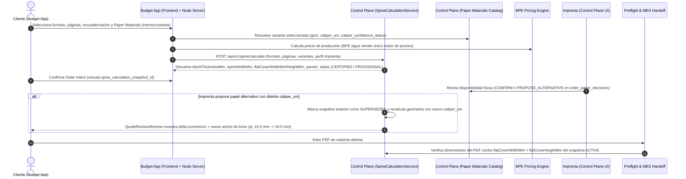

# SPINE-01 — Arquitectura de Integración End-to-End: Control Plane ↔ Paper Materials ↔ Budget App ↔ Preflight

**Misión:** `SPINE-01 — LIVONIA SPINE CALCULATOR: REVERSE ENGINEERING & ENGINE CONTRACT`  
**Repositorios implicados:** `PrintPriceOS/ppos-control-plane` y `PrintPriceOS/PrintPricePro_BookPrice`  
**Propósito:** Definir los contratos API, scopes RBAC, aislamiento multi-tenant, persistencia de snapshots inmutables, invalidación reactiva ante revisiones de papel y experiencia visual en Budget App y Control Plane.

---

## 1. Flujo End-to-End en PrintPrice OS



---

## 2. Integración en Control Plane (API, RBAC, Tenancy y Snapshots)

### 2.1 Superficies de API (`src/api/routes/spineRoutes.js`)

| Método y Ruta | Autenticación / Scope | Propósito |
| :--- | :--- | :--- |
| **`POST /api/v1/spine/calculate`** | Público autenticado por servicio (Budget App API Key / Session) o Actor Tenant (`SPINE_CALCULATE`) | Ejecuta `SpineCalculationService` de forma determinista. Si incluye `orderIntentId` o `persistSnapshot: true`, persiste la instantánea en `spine_calculation_snapshots`. |
| **`GET /api/v1/spine/profiles`** | Autenticado (`PRINTHOUSE_VIEWER`, `ADMIN`, o lectura pública filtrada por `CERTIFIED_ACTIVE`) | Lista los perfiles industriales de encuadernación activos para el `tenant_id` / `printhouse_id` (ej. `livonia-alegro-softcover@2.0.0`, `livonia-colibri-hardcover@2.0.0`). |
| **`GET /api/v1/spine/calculations/:id`** | Multi-tenant estricto (`req.actor.tenantId`) o Token de Pedido (`orderIntentId`) | Recupera una instantánea inmutable de cálculo de lomo y geometría de cubierta junto con sus hashes canónicos y advertencias. |
| **`PATCH /api/v1/spine/profiles/:profileId`** | `PRINTHOUSE_ADMIN` / `SUPERADMIN` | Permite a una imprenta parametrizar y versionar sus reglas de encuadernación (creando una nueva `profile_version` auditable sin mutar versiones previas). |

### 2.2 Esquema de Persistencia de Instantáneas (`spine_calculation_snapshots` — para `SPINE-03`)

```sql
CREATE TABLE IF NOT EXISTS spine_calculation_snapshots (
    id VARCHAR(64) PRIMARY KEY,
    tenant_id VARCHAR(64) NOT NULL,
    printhouse_id VARCHAR(64) NULL,
    external_order_intent_id VARCHAR(128) NULL,
    canonical_order_id VARCHAR(128) NULL,
    paper_decision_id VARCHAR(64) NULL,
    quote_revision_id VARCHAR(64) NULL,

    profile_id VARCHAR(64) NOT NULL,
    profile_version VARCHAR(32) NOT NULL,
    binding_category VARCHAR(32) NOT NULL,
    processing_type ENUM('GLUED', 'SEWN') NOT NULL,
    spine_shape ENUM('SQUARE', 'ROUND') NOT NULL DEFAULT 'SQUARE',

    -- Resultados geométricos clave indexables
    net_block_thickness_mm DECIMAL(8, 4) NOT NULL,
    total_block_with_endpapers_mm DECIMAL(8, 4) NOT NULL,
    spine_width_mm DECIMAL(8, 2) NULL,
    flat_cover_width_mm DECIMAL(8, 2) NULL,
    flat_cover_height_mm DECIMAL(8, 2) NULL,

    -- Estado epistémico y validación
    validation_status ENUM('CERTIFIED_VALID', 'PROVISIONAL_ESTIMATE', 'REQUIRES_TECH_REVIEW', 'INVALID_BLOCKED') NOT NULL,
    caliper_confidence_summary ENUM('VERIFIED', 'REFERENCE_IMPORTED', 'PROVISIONAL_ESTIMATED', 'MISSING') NOT NULL,
    snapshot_lifecycle_status ENUM('ACTIVE', 'SUPERSEDED', 'INVALIDATED') NOT NULL DEFAULT 'ACTIVE',

    -- Trazabilidad criptográfica e inmutabilidad
    input_canonical_hash CHAR(64) NOT NULL,
    output_canonical_hash CHAR(64) NOT NULL,
    input_payload_json JSON NOT NULL,
    geometry_breakdown_json JSON NOT NULL,
    validation_issues_json JSON NULL,

    created_at TIMESTAMP(6) NOT NULL DEFAULT CURRENT_TIMESTAMP(6),
    superseded_at TIMESTAMP(6) NULL,
    superseded_by_snapshot_id VARCHAR(64) NULL,

    INDEX idx_scs_tenant_intent (tenant_id, external_order_intent_id),
    INDEX idx_scs_order (canonical_order_id),
    INDEX idx_scs_status (snapshot_lifecycle_status)
) ENGINE=InnoDB DEFAULT CHARSET=utf8mb4 COLLATE=utf8mb4_unicode_ci;
```

### 2.3 Reglas de Invalidación Automática del Snapshot

Un snapshot `ACTIVE` en `spine_calculation_snapshots` (y su referencia en `order_effective_technical_specifications.specs_json.spine_geometry`) pasa automáticamente a **`SUPERSEDED` / `INVALIDATED`** cuando ocurre cualquiera de estos 5 eventos:

1. **Cambio de variante de papel interior (`INTERIOR`) o de su espesor (`caliper_um`):** Por ejemplo, cuando la imprenta emite un `PROPOSE_ALTERNATIVE` en [`orderPaperDecisionService.js`](file:///c:/Users/KIKE/Downloads/ppos-control-plane-phase-10-intelligence-layer/src/api/services/orderPaperDecisionService.js) (pasar de `G-Print 100 gsm / 98 µm` a `Munken Premium Cream 100 gsm / 175 µm` altera el bloque de 200 páginas de `9.80 mm` a `17.50 mm`).
2. **Cambio de variante de papel de cubierta (`COVER`) en encuadernación cosida (`SEWN`):** En el perfil Alegro, la fórmula de lomo cosido (`N2`) depende directamente de $\mu_{\text{cubierta}}$ (`E10`).
3. **Cambio en el número de páginas de cualquier segmento ($P_1, P_2$) o modo de guardas (`endpapersMode`).**
4. **Cambio en el formato de corte ($W \times H$), ancho de solapa ($F$) o grosor de cartón (`boardThicknessMm`).**
5. **Cambio de imprenta asignada (`printhouse_id`) o de método de encuadernación (`GLUED` ↔ `SEWN`, `ROUND` ↔ `SQUARE`).**

---

## 3. Integración con Revisiones de Cotización (`QuoteRevisionReview`) y Preflight

1. **En `orderQuoteRevisionService.js` y `QuoteRevisionReview.tsx`:**
   - Cuando la imprenta propone un papel alternativo (`PROPOSE_ALTERNATIVE`), `orderQuoteRevisionService` no solo invoca al BPE para el delta económico, sino que invoca a `SpineCalculationService` con el `caliper_um` de la variante alternativa.
   - En [`QuoteRevisionReview.tsx`](file:///C:/Users/KIKE/Downloads/PrintPricePro_BookPrice-feature-adversarial-node-v5.2/components/QuoteRevisionReview.tsx), además de mostrar la comparativa de papel y el desglose financiero, se mostrará el **Impacto en Geometría de Lomo y Cubierta** (ej. *"Lomo anterior: 15,0 mm → Nuevo lomo con papel alternativo: 18,0 mm (+3,0 mm). Si ya habías maquetado el PDF de cubierta, deberás ajustar el lomo a 18,0 mm"*).
2. **En `order_effective_technical_specifications` (Fase 196I) y Preflight:**
   - La puerta industrial `PREFLIGHT` verifica que el PDF de cubierta subido tenga dimensiones compatibles con `flat_cover_width_mm × flat_cover_height_mm` de la instantánea `ACTIVE` vigente, bloqueando cualquier PDF dimensionado con una instantánea `SUPERSEDED`.

---

## 4. Diseño de Experiencia en Budget App (`SPINE-04`)

Siguiendo estrictamente el **PrintPrice OS Design System** (`BUDGET-02D-04G` y `04H`: tarjetas `rounded-2xl`, paneles internos `rounded-xl`, badges `rounded-full`, acento `#dc0000`, soporte Dark/Light y responsive `320px–1440px`), se integrará el componente **`BookSpineGeometryPanel.tsx`** dentro de [`ConfigurationSummary.tsx`](file:///C:/Users/KIKE/Downloads/PrintPricePro_BookPrice-feature-adversarial-node-v5.2/components/ConfigurationSummary.tsx) y [`BookPriceForm.tsx`](file:///C:/Users/KIKE/Downloads/PrintPricePro_BookPrice-feature-adversarial-node-v5.2/components/BookPriceForm.tsx):

### 4.1 Estructura Visual del Panel en Budget App
- **Cabecera del Panel (`rounded-2xl border border-corporate-border bg-corporate-secondary p-5`):**
  - Título técnico: `BOOK SPINE & COVER GEOMETRY`
  - Badge de estado (`rounded-full px-2.5 py-0.5 text-[10px] font-bold uppercase`):
    - Verde esmeralda (`CERTIFIED · ALEGRO v2.0`): Cuando tanto el papel interior como la cubierta tienen `caliper_um` acreditado (`VERIFIED` o `REFERENCE_IMPORTED`) y el perfil es `CERTIFIED_ACTIVE`.
    - Ámbar (`PROVISIONAL ESTIMATE`): Cuando falta el espesor exacto de la variante y se usa una estimación provisional o cuando el perfil requiere revisión de tecnólogo (`HARDCOVER` / `UNCOATED > 29 mm`).
    - Rojo (`OUT OF MANUFACTURING LIMITS`): Cuando supera `78 mm` (cosido), `63 mm` (encolado) o el ancho máximo de solapa ($F > W - 16\text{ mm}$).
- **Tarjetas de Métricas Clave (Grid 2×2 en móvil, 4 columnas en desktop con `rounded-xl bg-corporate-primary p-3.5`):**
  1. **Block Thickness (`T_bloque`):** ej. `15.95 mm` (subtexto: `220 pp · 145 µm`).
  2. **Final Spine (`S`):** ej. `18.0 mm` (subtexto: `Sewn · Step 0.5 mm`).
  3. **Flat Cover + Bleed:** ej. `364.0 × 246.0 mm` (subtexto: `Includes 3 mm bleed`).
  4. **Net Open Cover:** ej. `358.0 × 240.0 mm` (o desglose con solapas `80 + 172 + 32.5 + 172 + 80 mm`).
- **Diagrama Técnico SVG Interactivo de Cubierta Extendida (`CoverSpreadDiagram`):**
  - Representación vectorial a escala con cotas técnicas (`Left Flap`, `Back Cover`, `Hinge/Score`, `Spine`, `Front Cover`, `Right Flap`, `Bleed / Turn-in`), adaptada a modo oscuro y claro.
- **Cero fórmulas duplicadas en el frontend:**
  - El componente de Budget App **nunca calcula por su cuenta las regresiones industriales de Alegro o Colibri**; consume la respuesta autoritativa del endpoint `/api/v1/spine/calculate` (a través del proxy de `server/server.js`) con debounce de `250 ms` al cambiar páginas, formato, encuadernación o variante de Paper Materials.

