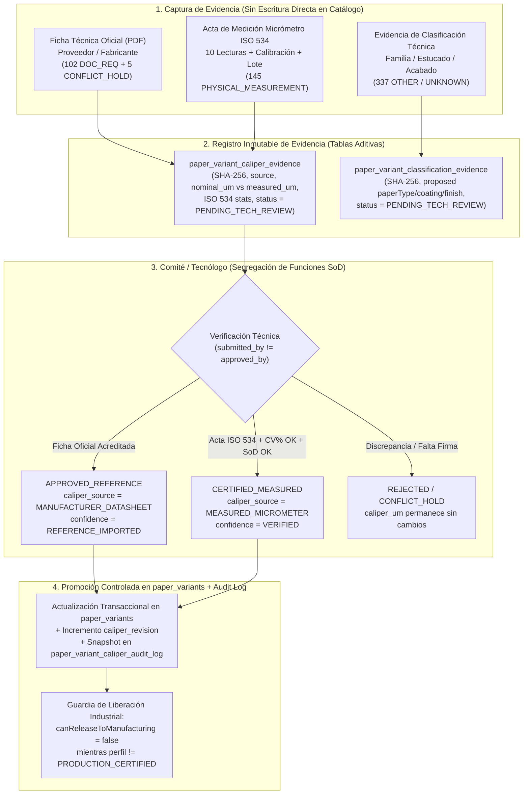

# PAPER-MATERIALS-RECOVERY-08 — Diseño de Integración de Evidencias y Flujo de Revisión en Paper Materials (`RECOVERY_08_EVIDENCE_WORKFLOW_DESIGN.md`)

**Proyecto:** PrintPrice OS (`PrintPriceOS/ppos-control-plane`)  
**Fase de Misión:** Fase 4 — Integración con Paper Materials  
**Referencia Base:** `src/api/services/spine/paperCaliperReconciliationService.js`, `src/api/services/spine/spineCalculationService.js`, `src/api/services/paperMaterialsNormalizationService.js`  
**Principio Rector:** **Cero alteración de enums productivos sin migración aditiva verificada · Separación absoluta entre `REFERENCE_IMPORTED` y certificación industrial (`VERIFIED` + `PRODUCTION_CERTIFIED`)**

---

## 1. Arquitectura y Flujo de Gobernanza de Evidencias

El programa `RECOVERY-08` introduce un diseño aditivo y no destructivo para registrar, auditar y promocionar evidencias técnicas de materiales de papel (tanto de **espesor / caliper** como de **clasificación técnica** independiente) sin romper ningún contrato existente de Control Plane, Spine Engine ni Budget App.



---

## 2. Compatibilidad con Enums y Contratos Existentes en `MySQL Control`

En la base de datos productiva (`MySQL Control`) y en [`paperCaliperReconciliationService.js`](../../src/api/services/spine/paperCaliperReconciliationService.js), las columnas actuales de `paper_variants` operan con los siguientes dominios:

- `caliper_source`:
  - `'MANUFACTURER_DATASHEET'`
  - `'MEASURED_MICROMETER'`
  - `'LIVONIA_REFERENCE_IMPORT'`
  - `'SUPPLIER_IMPORT'`
  - `'LEGACY_ODS_IMPORT'`
  - `'DERIVED_BULK_FORMULA'`
  - `'MISSING'`
- `caliper_confidence_status`:
  - `'VERIFIED'`
  - `'REFERENCE_IMPORTED'`
  - `'CONFLICT_HOLD'`
  - `'DERIVED_ESTIMATE'`
  - `'UNVERIFIED'`
  - `'MISSING'`

### 2.1. Invariante Crítico Ya Soportado en `resolveVariantCaliperProvenance`
En [`src/api/services/spine/paperCaliperReconciliationService.js`](../../src/api/services/spine/paperCaliperReconciliationService.js#L287-L305), cuando `caliper_confidence_status` vale explícitamente `'REFERENCE_IMPORTED'`, el motor **respeta `'REFERENCE_IMPORTED'`** incluso aunque `caliper_source` sea `'MANUFACTURER_DATASHEET'`:
- Por tanto, **no es necesario alterar ningún `ENUM` existente en `paper_variants`** para distinguir entre:
  1. **Ficha técnica importada como referencia controlada**:
     - `caliper_source = 'MANUFACTURER_DATASHEET'`
     - `caliper_confidence_status = 'REFERENCE_IMPORTED'`
  2. **Medición física de lote certificada por tecnólogo**:
     - `caliper_source = 'MEASURED_MICROMETER'`
     - `caliper_confidence_status = 'VERIFIED'`
  3. **Ficha técnica oficial homologada tras doble verificación de lote**:
     - `caliper_source = 'MANUFACTURER_DATASHEET'`
     - `caliper_confidence_status = 'VERIFIED'`

---

## 3. Diseño de Esquema Aditivo (Sin Modificar Columnas Existentes)

Para almacenar toda la riqueza documental exigida en la Fase 4 (documento técnico asociado, fuente y revisión, valor nominal frente a valor medido, confianza y procedencia, historial inmutable de cambios, estado de revisión y tecnólogo aprobador), se diseñan **tres tablas aditivas nuevas** que se despliegan mediante migración SQL idempotente sin bloquear ni alterar `paper_products` ni `paper_variants`.

### 3.1. Tabla `paper_variant_caliper_evidence` (Registro de Evidencias Documentales y Físicas)

```sql
CREATE TABLE IF NOT EXISTS paper_variant_caliper_evidence (
  evidence_id VARCHAR(64) NOT NULL PRIMARY KEY,
  tenant_id VARCHAR(64) NOT NULL DEFAULT 'default',
  variant_id VARCHAR(64) NOT NULL,
  product_id VARCHAR(64) NOT NULL,
  accreditation_track ENUM(
    'DATASHEET_REQUEST_TRACK',
    'PHYSICAL_MICROMETER_TRACK',
    'CONFLICT_RECONCILIATION_TRACK'
  ) NOT NULL,
  evidence_type ENUM(
    'MANUFACTURER_DATASHEET_PDF',
    'PHYSICAL_MICROMETER_RECORD',
    'COMBINED_DATASHEET_AND_MICROMETER'
  ) NOT NULL,

  -- 1. Documento técnico asociado y fuente/revisión
  document_title VARCHAR(255) NULL,
  document_storage_uri VARCHAR(512) NULL,
  document_sha256 CHAR(64) NULL,
  manufacturer_name VARCHAR(128) NOT NULL,
  supplier_channel VARCHAR(128) NULL,
  supplier_sku VARCHAR(128) NULL,
  datasheet_version VARCHAR(64) NULL,
  datasheet_published_date DATE NULL,
  measurement_standard VARCHAR(64) NOT NULL DEFAULT 'ISO 534:2011',
  shade_embossing_invariance_confirmed TINYINT(1) NOT NULL DEFAULT 0,

  -- 2. Valor nominal frente a valor medido por lote (separación explícita)
  nominal_datasheet_caliper_um INT NULL,
  nominal_tolerance_um DECIMAL(6,2) NULL,
  nominal_tolerance_pct DECIMAL(5,2) NULL,
  nominal_bulk_cm3_g DECIMAL(5,3) NULL,

  measured_batch_caliper_um INT NULL,
  measured_facestock_caliper_um INT NULL,
  measured_liner_caliper_um INT NULL,
  supplier_lot_batch_id VARCHAR(128) NULL,
  lot_received_date DATE NULL,
  conditioning_temp_c DECIMAL(4,1) NULL,
  conditioning_rh_pct DECIMAL(4,1) NULL,
  conditioning_hours DECIMAL(4,1) NULL,
  micrometer_make_model VARCHAR(128) NULL,
  micrometer_serial_number VARCHAR(64) NULL,
  micrometer_calibration_cert_id VARCHAR(128) NULL,
  micrometer_calibration_valid_until DATE NULL,
  readings_json JSON NULL,
  readings_count INT NULL,
  readings_mean_um DECIMAL(7,2) NULL,
  readings_std_dev_um DECIMAL(6,3) NULL,
  readings_cv_pct DECIMAL(5,2) NULL,
  readings_min_um INT NULL,
  readings_max_um INT NULL,

  -- 3. Confianza y procedencia objetivo
  proposed_effective_caliper_um INT NOT NULL,
  proposed_caliper_source VARCHAR(64) NOT NULL,
  proposed_confidence_status VARCHAR(64) NOT NULL,

  -- 4. Estado de revisión y segregación de funciones (SoD)
  review_status ENUM(
    'DRAFT',
    'PENDING_TECH_REVIEW',
    'APPROVED_REFERENCE',
    'CERTIFIED_MEASURED',
    'REJECTED',
    'SUPERSEDED'
  ) NOT NULL DEFAULT 'PENDING_TECH_REVIEW',
  submitted_by VARCHAR(128) NOT NULL,
  submitted_at DATETIME NOT NULL DEFAULT CURRENT_TIMESTAMP,
  approved_by_technologist VARCHAR(128) NULL,
  approved_at DATETIME NULL,
  rejection_reason TEXT NULL,
  technical_notes TEXT NULL,

  INDEX idx_pvce_variant_status (variant_id, review_status),
  INDEX idx_pvce_track_status (accreditation_track, review_status),
  INDEX idx_pvce_sha256 (document_sha256)
) ENGINE=InnoDB DEFAULT CHARSET=utf8mb4 COLLATE=utf8mb4_unicode_ci;
```

### 3.2. Tabla `paper_variant_caliper_audit_log` (Historial Inmutable de Cambios)

```sql
CREATE TABLE IF NOT EXISTS paper_variant_caliper_audit_log (
  audit_id VARCHAR(64) NOT NULL PRIMARY KEY,
  tenant_id VARCHAR(64) NOT NULL DEFAULT 'default',
  variant_id VARCHAR(64) NOT NULL,
  evidence_id VARCHAR(64) NOT NULL,
  previous_caliper_um INT NULL,
  new_caliper_um INT NULL,
  previous_caliper_mm DECIMAL(8,4) NULL,
  new_caliper_mm DECIMAL(8,4) NULL,
  previous_bulk_factor DECIMAL(6,3) NULL,
  new_bulk_factor DECIMAL(6,3) NULL,
  previous_caliper_source VARCHAR(64) NULL,
  new_caliper_source VARCHAR(64) NOT NULL,
  previous_confidence_status VARCHAR(64) NULL,
  new_confidence_status VARCHAR(64) NOT NULL,
  previous_revision INT NOT NULL DEFAULT 0,
  new_revision INT NOT NULL,
  nominal_datasheet_caliper_um INT NULL,
  measured_batch_caliper_um INT NULL,
  submitted_by VARCHAR(128) NOT NULL,
  approved_by_technologist VARCHAR(128) NOT NULL,
  applied_at DATETIME NOT NULL DEFAULT CURRENT_TIMESTAMP,
  rollback_of_audit_id VARCHAR(64) NULL,

  INDEX idx_pvcal_variant_rev (variant_id, new_revision),
  INDEX idx_pvcal_evidence (evidence_id)
) ENGINE=InnoDB DEFAULT CHARSET=utf8mb4 COLLATE=utf8mb4_unicode_ci;
```

### 3.3. Tabla `paper_variant_classification_evidence` (Flujo Independiente para Clasificaciones `OTHER / UNKNOWN`)

Siguiendo la directriz de la Fase 5 (*"Mantener este trabajo separado de la certificación de espesores"*), las evidencias de clasificación técnica (`paperType`, `coatingStatus`, `finish`) tienen su propia tabla y ciclo de revisión independiente:

```sql
CREATE TABLE IF NOT EXISTS paper_variant_classification_evidence (
  classification_evidence_id VARCHAR(64) NOT NULL PRIMARY KEY,
  tenant_id VARCHAR(64) NOT NULL DEFAULT 'default',
  variant_id VARCHAR(64) NOT NULL,
  product_id VARCHAR(64) NOT NULL,
  previous_category VARCHAR(64) NOT NULL,
  proposed_category ENUM('COATED', 'OFFSET', 'DESIGN', 'CARTON', 'OTHER') NOT NULL,
  previous_finish VARCHAR(64) NULL,
  proposed_finish VARCHAR(64) NOT NULL,
  proposed_coating_status ENUM('COATED', 'UNCOATED', 'SYNTHETIC', 'SPECIALTY', 'UNKNOWN') NOT NULL,
  evidence_source_type ENUM('MILL_DATASHEET', 'SUPPLIER_CATALOG_SPEC', 'ODS_EXPLICIT_HEADER') NOT NULL,
  document_title VARCHAR(255) NOT NULL,
  document_sha256 CHAR(64) NULL,
  review_status ENUM('PENDING_TECH_REVIEW', 'APPROVED', 'REJECTED') NOT NULL DEFAULT 'PENDING_TECH_REVIEW',
  submitted_by VARCHAR(128) NOT NULL,
  submitted_at DATETIME NOT NULL DEFAULT CURRENT_TIMESTAMP,
  approved_by_technologist VARCHAR(128) NULL,
  approved_at DATETIME NULL,
  notes TEXT NULL,

  INDEX idx_pvcle_variant (variant_id, review_status)
) ENGINE=InnoDB DEFAULT CHARSET=utf8mb4 COLLATE=utf8mb4_unicode_ci;
```

---

## 4. Máquina de Estados y Reglas de Negocio del Flujo de Revisión

### 4.1. Reglas de Validación antes de Aprobar una Evidencia de Espesor

| Regla ID | Condición Verificada por el Servicio de Acreditación | Resultado si Falla |
| :--- | :--- | :--- |
| **`EVD-01`** | Si `accreditation_track === 'DATASHEET_REQUEST_TRACK'`, debe existir `document_sha256` (64 hex chars), `datasheet_version`, `datasheet_published_date`, `nominal_datasheet_caliper_um > 0` y `shade_embossing_invariance_confirmed = 1`. | `422 Unprocessable Entity` (`MISSING_MANDATORY_TDS_METADATA`) |
| **`EVD-02`** | Si `accreditation_track === 'PHYSICAL_MICROMETER_TRACK'`, debe existir `readings_count >= 10`, `micrometer_calibration_valid_until >= lot_received_date`, `conditioning_temp_c BETWEEN 22.0 AND 24.0`, `conditioning_rh_pct BETWEEN 48.0 AND 52.0`, y `readings_cv_pct` dentro del umbral de la categoría (`≤ 3.5%` lisos / `≤ 5.0%` gofrados). | `422 Unprocessable Entity` (`ISO_534_METROLOGY_PROTOCOL_VIOLATION`) |
| **`EVD-03`** | Segregación de funciones (SoD): `submitted_by !== approved_by_technologist`. | `403 Forbidden` (`SOD_SELF_APPROVAL_FORBIDDEN`) |
| **`EVD-04`** | Protección de los 9 conflictos históricos (`LIVONIA_REFERENCE_IMPORT`) y 5 `CONFLICT_HOLD`: no pueden actualizarse mediante importación masiva; exigen arbitraje individual con `accreditation_track = 'CONFLICT_RECONCILIATION_TRACK'` y adjunto de confirmación escrita del molino. | `409 Conflict` (`CONFLICT_HOLD_ARBITRATION_REQUIRED`) |
| **`EVD-05`** | Separación `REFERENCE_IMPORTED` vs `VERIFIED`: una evidencia sólo documental (`MANUFACTURER_DATASHEET_PDF` sin medición física de lote en planta) promueve la variante a `caliper_confidence_status = 'REFERENCE_IMPORTED'`. La promoción a `'VERIFIED'` exige acta física `ISO 534` (`CERTIFIED_MEASURED`) o doble validación firmada de fábrica + laboratorio. | Imposición automática en servidor (`server-enforced confidence cap`) |
| **`EVD-06`** | Bloqueo de liberación industrial: `canReleaseToManufacturing` en `spineCalculationService.js` exige simultáneamente `caliperConfidenceStatus === 'VERIFIED'` **y** `profileConfidenceStatus === 'PRODUCTION_CERTIFIED'`. Mientras los perfiles de plegado/encuadernación sigan en `REFERENCE_IMPORTED`, `canReleaseToManufacturing` permanece `false`. | Garantizado por [`spineCalculationService.js`](../../src/api/services/spine/spineCalculationService.js#L134-L162) |

---

## 5. Diseño de Endpoints BFF / Control Plane (Rutas Gobernadas por RBAC y Tenant)

Todos los endpoints se montan bajo `/api/admin/paper-materials/accreditation` con autenticación obligatoria de operador/tecnólogo y aislamiento estricto de `tenant_id`:

1. **`GET /api/admin/paper-materials/accreditation/inventory`**
   - Devuelve el resumen en tiempo real de las `1.524` variantes (`1.272` con espesor, `252` pendientes desglosadas en `102` `DOCUMENTATION_REQUIRED`, `145` `PHYSICAL_MEASUREMENT_REQUIRED`, `5` `CONFLICT_HOLD`, y `337` clasificaciones `OTHER / UNKNOWN`).
2. **`POST /api/admin/paper-materials/accreditation/caliper-evidence`**
   - Registra una nueva propuesta documental (`MANUFACTURER_DATASHEET_PDF`) o acta micrométrica (`PHYSICAL_MICROMETER_RECORD`) en estado `PENDING_TECH_REVIEW`, sin tocar `paper_variants`.
3. **`POST /api/admin/paper-materials/accreditation/caliper-evidence/:evidenceId/approve`**
   - Ejecutable únicamente por rol `MATERIAL_TECHNOLOGIST` o `CONTROL_PLANE_ADMIN` distinto de `submitted_by`.
   - Verifica las reglas `EVD-01` a `EVD-06`, actualiza `paper_variants` dentro de una transacción (`caliper_um`, `caliper_mm = ROUND(caliper_um / 1000, 4)`, `bulk_factor = ROUND(caliper_um / gsm, 3)`, `caliper_source`, `caliper_confidence_status`, `caliper_revision = caliper_revision + 1`, `caliper_updated_at = NOW()`), e inserta el registro inmutable en `paper_variant_caliper_audit_log`.
4. **`POST /api/admin/paper-materials/accreditation/caliper-evidence/:evidenceId/reject`**
   - Marca la evidencia como `REJECTED` con motivo técnico obligatorio; `paper_variants` permanece intacta.
5. **`GET /api/admin/paper-materials/accreditation/variants/:variantId/history`**
   - Devuelve la trazabilidad histórica completa: valor nominal de ficha frente a mediciones de lote por micrómetro, revisiones, hashes SHA-256 de documentos y tecnólogos firmantes.

---

## 6. Plan de Pruebas de Compatibilidad antes de Migración Productiva

Antes de ejecutar cualquier `CREATE TABLE` en `MySQL Control` en una futura misión de implementación (`RECOVERY-09`), la suite de pruebas verifica:

1. **Invarianza de lectura del catálogo actual**: `resolveVariantCaliperProvenance` y `resolveVariantTechnicalAttributes` producen resultados 100 % idénticos para las `1.524` variantes existentes.
2. **Validación estadística del protocolo `ISO 534`**: cálculo determinista de $\bar{x}$, $s$, $\text{CV}\%$, $\Delta_{\max}\%$ y bloqueo automático cuando $\text{CV}\%$ excede el límite de la familia o el certificado de calibración ha expirado.
3. **Verificación de Segregación de Funciones (SoD)**: rechazo automático cuando el operador que registra el acta intenta aprobarla.
4. **No regresión de `canReleaseToManufacturing = false`**: incluso cuando una variante alcanza `MEASURED_MICROMETER` + `VERIFIED`, si el perfil de máquina/encuadernación tiene `confidence_status = 'REFERENCE_IMPORTED'`, la salida hacia fabricación permanece bloqueada (`manufacturingReleaseStatus = 'BLOCKED'`).

