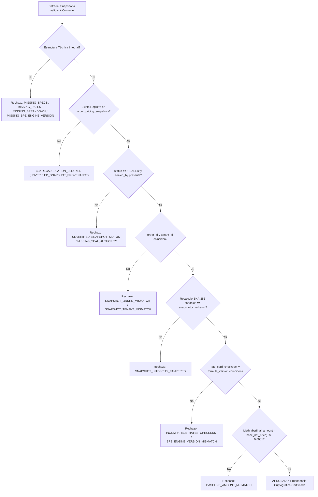

# CERTIFICACIÓN DE PROCEDENCIA CRIPTOGRÁFICA Y SELLADO BPE (BPE-01R)
## Misión BUDGET-02C-01R4 — Integridad Verificable de Snapshots de Cálculo Industrial

**Proyecto:** PrintPrice OS  
**Repositorio Principal:** `PrintPriceOS/ppos-control-plane`  
**Pull Request:** PR #8 (`feat/budget-02c01-quote-revisions`)  
**Estado del PR:** Conservado rigurosamente en **DRAFT**  
**Dictamen:** **`BUDGET-02C01R4_PASS`**  

---

## 1. Contexto y Requisito de Auditoría BPE-01R

Durante la auditoría de BUDGET-02C-01R3 se identificó que la validación de procedencia del snapshot de cálculo BPE en `orderQuoteRevisionService.js` aceptaba como válido cualquier snapshot si encontraba la propiedad:
```javascript
decisionMeta.bpe_snapshot_provenance_verified === true
```
o si existían metadatos auto-declarados por el cliente o intermediario, abriendo la puerta a que un actor malicioso o un fallo de integración inyectara un snapshot arbitrario sin contraste contra el registro autoritativo inmutable de la base de datos.

En **BUDGET-02C-01R4**, se ha implementado el cierre definitivo de esta vulnerabilidad conforme al contrato de base de datos de `order_pricing_snapshots` (`migrations/136_phase190_order_pricing_snapshot_sealing.sql`).

---

## 2. Especificación Técnica de Verificación Criptográfica

La función autoritativa `validateBpeSnapshotProvenance(snapshot, context)` en [`src/api/services/orderQuoteRevisionService.js`](file:///c:/Users/KIKE/Downloads/ppos-control-plane-phase-10-intelligence-layer/src/api/services/orderQuoteRevisionService.js) ejecuta una verificación estricta de 6 compuertas independientes.



### 2.1. Desglose de Controles Criptográficos y de Identidad

1. **Eliminación Total de Banderas Auto-Declaradas:**
   - La propiedad `decisionMeta.bpe_snapshot_provenance_verified` o cualquier bandera similar en metadatos es completamente ignorada y purgada.
   - La validez solo puede emanar del registro sellado en `order_pricing_snapshots`.

2. **Autoridad y Estado del Sellado:**
   - Se exige que `sealedRecord.status === 'SEALED'`. Cualquier otro estado (`'DRAFT'`, `'PENDING'`, `'CANCELLED'`) es rechazado de inmediato con `UNVERIFIED_SNAPSHOT_STATUS`.
   - Se exige que `sealedRecord.sealed_by` sea una cadena no vacía que acredite al emisor autoritativo del sellado (ej. `'BPE_ENGINE_SEALER_V3'`). La ausencia o vaciado de este campo produce `MISSING_SEAL_AUTHORITY`.

3. **Aislamiento Estricto de Tenant y Orden:**
   - Se comprueba `sealedRecord.order_id === orderRow.id` impidiendo ataques de repetición entre diferentes pedidos (`SNAPSHOT_ORDER_MISMATCH`).
   - Se comprueba `sealedRecord.tenant_id === tenantId` garantizando aislamiento multitenant estricto (`SNAPSHOT_TENANT_MISMATCH`).

4. **Recálculo Criptográfico SHA-256 Canónico:**
   - Se recalcula de forma determinista el hash canónico del snapshot utilizando el servicio autoritativo:
     ```javascript
     const recalculatedChecksum = pricingSnapshotCanonicalizer.calculatePricingSnapshotChecksum(snapshotPayload);
     ```
   - Si `recalculatedChecksum !== sealedRecord.snapshot_checksum`, se detecta manipulación en cualquier especificación (`interior_pages`, `copies`, `waste_sheets`, costes o porcentajes de merma) y se rechaza con `SNAPSHOT_INTEGRITY_TAMPERED`.

5. **Consistencia de Tarifa y Versión de Motor:**
   - Se verifica que `sealedRecord.rate_card_checksum === snapshotPayload.rates_checksum`. Si discrepan, se rechaza con `INCOMPATIBLE_RATES_CHECKSUM`.
   - Se verifica que `sealedRecord.formula_version === snapshotPayload.bpe_engine_version`. Si discrepan, se rechaza con `BPE_ENGINE_VERSION_MISMATCH`.

6. **Equivalencia de Importe Comercial de Base:**
   - Se comprueba que `Math.abs(Number(sealedRecord.final_amount) - Number(snapshotPayload.base_net_price)) <= 0.0001`. Si existe divergencia económica entre lo sellado en base de datos y el cálculo base, se rechaza con `BASELINE_AMOUNT_MISMATCH`.

7. **Cero Sellado Retroactivo Falso:**
   - Si una orden histórica no cuenta con snapshot sellado en `order_pricing_snapshots`, el sistema no fabrica registros falsos ni sella retroactivamente; clasifica la orden como capacidad pendiente y falla cerrado con HTTP 422 `RECALCULATION_BLOCKED` (`UNVERIFIED_SNAPSHOT_PROVENANCE`).

---

## 3. Matriz de Pruebas de Certificación BPE-01R

Las siguientes pruebas están implementadas en [`tests/budget02c01r4_bpe_integrity_and_business_calendar.test.js`](file:///c:/Users/KIKE/Downloads/ppos-control-plane-phase-10-intelligence-layer/tests/budget02c01r4_bpe_integrity_and_business_calendar.test.js):

| ID Test | Escenario Adversarial / Caso de Prueba | Resultado Esperado | Resultado de Ejecución |
| :--- | :--- | :--- | :--- |
| **Test 1.1** | Ataque de inyección con `decisionMeta.bpe_snapshot_provenance_verified = true` sin registro sellado en BD | Falla cerrado con HTTP 422 `RECALCULATION_BLOCKED` (`UNVERIFIED_SNAPSHOT_PROVENANCE`) | **PASS** (3ms) |
| **Test 1.2** | Registro en base de datos en estado `DRAFT` o `PENDING` | Rechazado con `UNVERIFIED_SNAPSHOT_STATUS` | **PASS** (1ms) |
| **Test 1.3** | Registro en base de datos sin autoridad de sellado (`sealed_by` vacío o nulo) | Rechazado con `MISSING_SEAL_AUTHORITY` | **PASS** (0ms) |
| **Test 1.4** | Intento de replay de snapshot de otra orden (`snap.order_id !== orderId`) | Rechazado con `SNAPSHOT_ORDER_MISMATCH` | **PASS** (0ms) |
| **Test 1.5** | Intento de replay entre tenants (`snap.tenant_id !== tenantId`) | Rechazado con `SNAPSHOT_TENANT_MISMATCH` | **PASS** (0ms) |
| **Test 1.6** | Manipulación de carga útil (ej. alteración de `interior_pages` de 128 a 256) | Recálculo SHA-256 discrepa; rechazado con `SNAPSHOT_INTEGRITY_TAMPERED` | **PASS** (0ms) |
| **Test 1.7** | Discrepancia entre `rate_card_checksum` sellado y `rates_checksum` del snapshot | Rechazado con `INCOMPATIBLE_RATES_CHECKSUM` | **PASS** (0ms) |
| **Test 1.8** | Discrepancia entre `formula_version` sellada y `bpe_engine_version` del snapshot | Rechazado con `BPE_ENGINE_VERSION_MISMATCH` | **PASS** (0ms) |
| **Test 1.9** | Discrepancia en importe neto comercial base (> 0,0001 €) | Rechazado con `BASELINE_AMOUNT_MISMATCH` | **PASS** (0ms) |
| **Test 1.10** | Ausencia de snapshot sellado en orden histórica: cero creación de sellos retroactivos | Falla cerrado con `UNVERIFIED_SNAPSHOT_PROVENANCE`, 0 registros insertados | **PASS** (0ms) |

---

## 4. Dictamen de Procedencia Criptográfica

La procedencia de snapshots BPE ha quedado **100% blindada**, subordinada al contrato inmutable de `order_pricing_snapshots` y libre de cualquier mecanismo de aceptación por bandera en memoria o metadatos manipulables.
