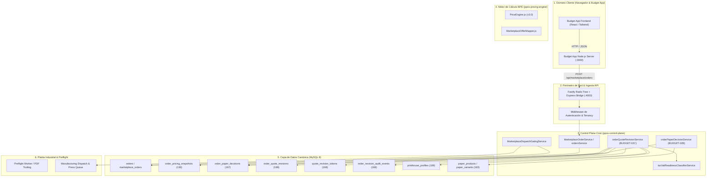
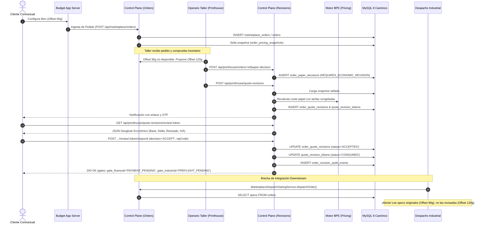

# BUDGET-02D-00 — Arquitectura del Flujo y Mapa Integral de Integración End-to-End

**Proyecto:** PrintPrice OS  
**Misión:** BUDGET-02D-00 — Auditoría Integral de Integración E2E  
**Estado:** AUDIT ONLY — READ ONLY  
**Referencia Certificada:** `744bdd89676c92de2c612152e1be58fe48698fd9`  
**PR:** #8 — OPEN / DRAFT  

---

## 1. Topología del Sistema y Límites de Confianza

El flujo comercial e industrial de PrintPrice OS comprende cinco dominios distribuidos con distintos niveles de confianza, protocolos y motores de cálculo:



---

## 2. Mapa Detallado del Recorrido End-to-End

### Fase 1: Presupuesto y Creación de Intención de Pedido (Budget App)
1. **Configuración en Frontend**: El cliente configura pliegos, páginas, encuadernación y papel en [BookPriceForm.tsx](file:///C:/Users/KIKE/Downloads/PrintPricePro_BookPrice-feature-adversarial-node-v5.2/components/BookPriceForm.tsx) o [AdvancedPaperSelector.tsx](file:///C:/Users/KIKE/Downloads/PrintPricePro_BookPrice-feature-adversarial-node-v5.2/components/AdvancedPaperSelector.tsx).
2. **Generación de Ofertas**: El servidor de Budget App invoca al motor de cálculo BPE o Control Plane (`/api/marketplace/offers`).
3. **Selección y Guardado**: Se crea un `order_intent` en [server.js](file:///C:/Users/KIKE/Downloads/PrintPricePro_BookPrice-feature-adversarial-node-v5.2/server/server.js#L1150) con `public_ref`, snapshot de oferta seleccionada (`selected_offer_snapshot`) y archivos PDF asociados.
4. **Handoff a Control Plane**: Al confirmar pago/finalización, Budget App invoca [server.js](file:///C:/Users/KIKE/Downloads/PrintPricePro_BookPrice-feature-adversarial-node-v5.2/server/server.js#L3932-L3950):
   ```js
   POST ${CONTROL_PLANE_BASE_URL}${CONTROL_PLANE_ORDER_ENDPOINT}
   ```
   donde `CONTROL_PLANE_ORDER_ENDPOINT` por defecto apunta a `/api/admin/orders`.

---

### Fase 2: Ingesta y Persistencia en Control Plane
1. **Recepción en Control Plane**:
   - `POST /api/marketplace/orders` gestionado por [marketplaceOrders.js](file:///c:/Users/KIKE/Downloads/ppos-control-plane-phase-10-intelligence-layer/src/api/routes/marketplaceOrders.js) y [marketplaceOrderService.js](file:///c:/Users/KIKE/Downloads/ppos-control-plane-phase-10-intelligence-layer/src/api/services/marketplaceOrderService.js#L258).
   - `POST /api/admin/orders` gestionado por [admin.js](file:///c:/Users/KIKE/Downloads/ppos-control-plane-phase-10-intelligence-layer/src/api/routes/admin.js) y [ordersService.js](file:///c:/Users/KIKE/Downloads/ppos-control-plane-phase-10-intelligence-layer/src/api/services/ordersService.js).
2. **Bifurcación de Esquema**:
   - Si se llama a `/api/marketplace/orders`, el registro se inserta en `marketplace_orders` (con `book_spec_json`, `selected_offer_json`, `customer_json`).
   - Si se llama a `/api/admin/orders`, el registro se inserta en `orders` (con `specs`, `offers_snapshot`, `offer_print_house`).
3. **Sellado Criptográfico Inicial (Snapshots)**:
   - Se ejecuta [quoteService.acceptQuoteAndSealOrderPricing](file:///c:/Users/KIKE/Downloads/ppos-control-plane-phase-10-intelligence-layer/src/api/services/quoteService.js#L175-L188) para generar `order_pricing_snapshots` con checksum SHA-256 canónico.

---

### Fase 3: Decisión Técnica de Papel en Taller (BUDGET-02B)
1. **Detección de Falta de Stock**: El operario del taller asignado detecta indisponibilidad del papel solicitado (ej. Offset 90g agotado).
2. **Emisión de Decisión**:
   - Ruta: `POST /api/printhouse/orders/:orderRef/paper-decision` (montada en [printhouseOrders.js](file:///c:/Users/KIKE/Downloads/ppos-control-plane-phase-10-intelligence-layer/src/api/routes/printhouseOrders.js#L322)).
   - Servicio: [orderPaperDecisionService.recordDecision](file:///c:/Users/KIKE/Downloads/ppos-control-plane-phase-10-intelligence-layer/src/api/services/orderPaperDecisionService.js#L402).
   - Acción: `PROPOSE_ALTERNATIVE` especificando `alternativeVariantId` (ej. Offset 120g).
3. **Garantía Inviolable**:
   - La decisión se bloquea a nivel de base de datos (`active_role_slot`).
   - Se clasifica automáticamente como `REQUIRES_ECONOMIC_REVISION`.
   - El precio del cliente NO se modifica en esta fase (Delta cliente = 0.0000 no vinculante).

---

### Fase 4: Recálculo BPE y Emisión de Revisión Gobernada (BUDGET-02C)
1. **Emisión de Revisión**:
   - Ruta: `POST /api/printhouse/quote-revisions` (documentada erróneamente como `/api/marketplace/quote-revisions`).
   - Servicio: [OrderQuoteRevisionService.createQuoteRevision](file:///c:/Users/KIKE/Downloads/ppos-control-plane-phase-10-intelligence-layer/src/api/services/orderQuoteRevisionService.js#L1000).
2. **Puertas de Control**:
   - **Puerta 1 (Identidad y Snapshots)**: Carga `order_pricing_snapshots` sellado con verificación canónica SHA-256. Falla si falta `tenant_id` o si el checksum no coincide.
   - **Puerta 2 (Recálculo BPE)**: [recalculateDeterministicBpePrice](file:///c:/Users/KIKE/Downloads/ppos-control-plane-phase-10-intelligence-layer/src/api/services/orderQuoteRevisionService.js#L571) calcula el diferencial de coste de papel sobre tarifas congeladas, manteniendo estrictamente congelados los costes de impresión, cubiertas, guardas y encuadernación.
   - **Puerta 3 (Clasificación Fiscal)**: [taxVatReadinessClassifierService.classifyReadiness](file:///c:/Users/KIKE/Downloads/ppos-control-plane-phase-10-intelligence-layer/src/api/services/taxVatReadinessClassifierService.js#L43) calcula el tipo de IVA aplicable (4% libros vs 21% estándar) y genera las cuotas independientes.
   - **Puerta 4 (Horas Hábiles y Caducidad)**: Carga [printhouse_profiles](file:///c:/Users/KIKE/Downloads/ppos-control-plane-phase-10-intelligence-layer/migrations/169_phase196h_printhouse_profiles.sql) y proyecta el vencimiento según calendario laboral del taller (`TIME-01R`).
3. **Persistencia y Token Monouso**:
   - Se crea registro en `order_quote_revisions` (`status = 'PENDING'`).
   - Se genera token criptográfico de 256 bits (`quote_revision_tokens`) con hash SHA-256 (sin texto claro en BD).
   - Si `deltaNet > 50.00 €`, se despacha OTP vía [OtpDeliveryService](file:///c:/Users/KIKE/Downloads/ppos-control-plane-phase-10-intelligence-layer/src/api/services/orderQuoteRevisionService.js#L806).

---

### Fase 5: Previsualización y Respuesta del Cliente
1. **Previsualización de Solo Lectura**:
   - Ruta: `GET /api/printhouse/quote-revisions/review/:token` (montada en [orderQuoteRevisionRoutes.js](file:///c:/Users/KIKE/Downloads/ppos-control-plane-phase-10-intelligence-layer/src/api/routes/orderQuoteRevisionRoutes.js#L125)).
   - No consume el token, no incrementa contadores, inmune a web crawlers o prefetching.
2. **Aceptación / Rechazo**:
   - Ruta: `POST /api/printhouse/quote-revisions/review/:token/respond`.
   - Servicio: [OrderQuoteRevisionService.respondToQuoteRevision](file:///c:/Users/KIKE/Downloads/ppos-control-plane-phase-10-intelligence-layer/src/api/services/orderQuoteRevisionService.js#L1700).
   - Si `deltaNet > 50 €`, exige OTP válido o sesión autenticada vinculada.
   - Consume el token (`status = 'CONSUMED'`), marca la revisión como `ACCEPTED` o `REJECTED`, y emite evento inmutable en `order_revision_audit_events`.

---

### Fase 6: Compuertas Financieras e Industriales Downstream
1. **Compuertas Triples Evaluadas**:
   ```js
   const gates = {
       gate_contractual: decision === 'ACCEPT' ? 'PASSED' : 'REJECTED',
       gate_financial: decision === 'ACCEPT' && deltaNet > 0 ? 'PAYMENT_PENDING' : 'PASSED',
       gate_industrial: 'PREFLIGHT_PENDING'
   };
   ```
2. **Transición a Producción**:
   - `MarketplaceDispatchGatingService.dispatchOrder` comprueba validación de archivos (`production_files.validation_status = 'VALIDATED'`) y estado de pago (`invoice_payment.payment_status = 'PAID'`).
   - Envío a cola de máquina en taller (`ManufacturingDispatchService.createDispatch`).

---

## 3. Fracturas y Desconexiones Críticas de la Topología Actual

Tras la auditoría de código, se han localizado cuatro puntos críticos de desconexión arquitectónica:

| # | Fractura Topológica | Componente Origen | Componente Destino | Manifestación Técnica | Severidad |
|---|---|---|---|---|---|
| **F-01** | **Prefijo de Rutas Desalineado** | Frontend Cliente / Budget App (`/api/marketplace/quote-revisions/*`) | Control Plane Fastify Router (`/api/printhouse/quote-revisions/*`) | `server.js` monta las rutas bajo `/api/printhouse`. Clientes que consultan `/api/marketplace/quote-revisions` reciben `HTTP 404 Endpoint not found`. | **HIGH** |
| **F-02** | **Falta de Trazabilidad tenant_id en Sellado Histórico** | [quoteService.js](file:///c:/Users/KIKE/Downloads/ppos-control-plane-phase-10-intelligence-layer/src/api/services/quoteService.js#L177-L188) | [order_pricing_snapshots](file:///c:/Users/KIKE/Downloads/ppos-control-plane-phase-10-intelligence-layer/migrations/136_phase190_order_pricing_snapshot_sealing.sql) | La sentencia SQL `INSERT INTO order_pricing_snapshots` no incluye la columna obligatoria `tenant_id`. Falla en MySQL 8 o impide la validación posterior en BUDGET-02C (`MISSING_SEALED_TENANT_ID`). | **CRITICAL** |
| **F-03** | **Compuertas No Persistidas en Tablas Principales** | [orderQuoteRevisionService.js](file:///c:/Users/KIKE/Downloads/ppos-control-plane-phase-10-intelligence-layer/src/api/services/orderQuoteRevisionService.js#L1891-L1908) | `order_quote_revisions` / `orders` | Las compuertas (`gate_contractual`, `gate_financial`, `gate_industrial`) solo existen en memoria y en el payload JSON del evento de auditoría. Ningún servicio SQL downstream puede consultarlas por columna. | **MEDIUM** |
| **F-04** | **Desconexión entre Revisión Aceptada y Despacho Industrial** | [orderQuoteRevisionService.js](file:///c:/Users/KIKE/Downloads/ppos-control-plane-phase-10-intelligence-layer/src/api/services/orderQuoteRevisionService.js#L1875) | [MarketplaceDispatchGatingService.js](file:///c:/Users/KIKE/Downloads/ppos-control-plane-phase-10-intelligence-layer/src/api/services/MarketplaceDispatchGatingService.js#L51-L68) | La aceptación de la revisión NO actualiza `orders.specs` ni `marketplace_orders.book_spec_json`. El despacho industrial envía a máquina las especificaciones viejas (el papel agotado original). | **CRITICAL** |

---

## 4. Diagrama de Secuencia End-to-End


