# BUDGET-02D-00 — Informe Final de Auditoría de Integración End-to-End

**Proyecto:** PrintPrice OS  
**Misión:** BUDGET-02D-00 — Auditoría Integral de Integración E2E  
**Estado:** AUDIT ONLY — READ ONLY (No Code Changes, No Merge, No Deploy)  
**Referencia Certificada:** `744bdd89676c92de2c612152e1be58fe48698fd9`  
**PR Principal:** #8 — OPEN / DRAFT  
**Estado de Entrada:** `BUDGET-02C01R4V_PASS`  
**Fecha de Emisión:** 27 de Octubre de 2026  

---

## 1. Dictamen Ejecutivo de Auditoría

### DICTAMEN: CONDITIONAL (NO APTO PARA PRODUCCIÓN SIN REMEDIACIÓN DE FRACTURAS CRÍTICAS)

**Fundamento Técnico del Dictamen**:
La arquitectura conceptual, los esquemas relacionales de las migraciones 167, 168 y 169, la criptografía de tokens de 256 bits y el motor de clasificación fiscal son excepcionalmente sólidos y cumplen con los más rigurosos estándares de seguridad y trazabilidad.

Sin embargo, la integración **End-to-End no puede ser certificada con PASS** debido a la presencia de **3 bloqueantes críticos y 3 bloqueantes de severidad alta** que impiden la interoperabilidad real entre Budget App, Control Plane y el Despacho Industrial:
1. **Ruptura de Consulta SQL en Pedidos Reales**: [orderQuoteRevisionService.js:1054](file:///c:/Users/KIKE/Downloads/ppos-control-plane-phase-10-intelligence-layer/src/api/services/orderQuoteRevisionService.js#L1054) consulta la columna inexistente `customer_email` en `marketplace_orders`, provocando un fallo fatal en MySQL 8 para todo pedido originado en la tienda (`BLK-02`).
2. **Defecto de Sellado Histórico**: [quoteService.js:176-188](file:///c:/Users/KIKE/Downloads/ppos-control-plane-phase-10-intelligence-layer/src/api/services/quoteService.js#L176-L188) omite la columna obligatoria `tenant_id` al insertar en `order_pricing_snapshots`, rompiendo la base de cálculo requerida por BUDGET-02C (`BLK-01`).
3. **Desconexión con la Fábrica**: Cuando el cliente acepta la propuesta de papel, [orderQuoteRevisionService.js:1875](file:///c:/Users/KIKE/Downloads/ppos-control-plane-phase-10-intelligence-layer/src/api/services/orderQuoteRevisionService.js#L1875) nunca actualiza las especificaciones técnicas (`specs`) en la tabla de pedidos. Al despachar a máquina, el sistema envía a imprimir el papel viejo agotado (`BLK-03`).
4. **Desalineación de Rutas en API Gateway**: Las rutas de revisión están montadas en `/api/printhouse/*` en lugar de `/api/marketplace/*`, resultando en `HTTP 404 Endpoint not found` para los enlaces del cliente (`BLK-04`).
5. **Supervivencia de Consentimiento ante Cancelación**: La aceptación del token no valida el estado del pedido padre, permitiendo consentir cambios en pedidos cancelados o reasignados (`BLK-05`).
6. **Vacío en Diferenciales Negativos**: Un $\Delta < 0$ pasa a `PASSED` sin registrar orden de reembolso ni nota de crédito (`BLK-06`).

---

## 2. Evaluación por Compuertas de Auditoría (Gates 1 al 9)

```mermaid
graph LR
    G1["Gate 1: Trazabilidad Pedido<br/>(PARTIAL)"] --> G2["Gate 2: Decisiones Papel<br/>(PASS)"]
    G2 --> G3["Gate 3: Snapshot BPE<br/>(CONDITIONAL)"]
    G3 --> G4["Gate 4: Integración Fiscal<br/>(PASS)"]
    G4 --> G5["Gate 5: Consentimiento<br/>(CONDITIONAL)"]
    G5 --> G6["Gate 6: Compuertas<br/>(CONDITIONAL)"]
    G6 --> G7["Gate 7: Contratos API<br/>(FAIL)"]
    G7 --> G8["Gate 8: Datos MySQL 8<br/>(CONDITIONAL)"]
    G8 --> G9["Gate 9: Matriz E2E<br/>(9 PASS / 3 BLK / 4 FAIL)"]
```

### GATE 1 — Trazabilidad del Pedido: PARTIAL
- **Logro**: Mapeo completo de identificadores externos (`order_intent_id`) y canónicos (`canonical_order_id`).
- **Defecto**: Bifurcación entre `orders` y `marketplace_orders`. El servicio de revisión falla en MySQL 8 por intentar leer `customer_email` como columna física de `marketplace_orders`.

### GATE 2 — Decisiones Técnicas de Papel (BUDGET-02B): PASS
- **Logro**: Aislamiento estricto de inquilinos y talleres. Concurrencia garantizada por columna generada `active_role_slot` e índice único. Idempotencia con huella digital SHA-256. El presupuesto original del cliente permanece estrictamente inmutable.

### GATE 3 — Snapshot BPE y Cálculo Delta (BUDGET-02C): CONDITIONAL
- **Logro**: Verificación criptográfica con `pricingSnapshotCanonicalizer.js` e inmutabilidad profunda (`deepFreeze`). Recálculo de costes de papel idéntico a BPE en pliegos y kilos.
- **Defecto**: Inserción histórica en `order_pricing_snapshots` carece de `tenant_id`. Discrepancia en recálculo de transporte cuando las tarifas del taller aplican `technical_costs_for_transport = true`.

### GATE 4 — Integración Fiscal: PASS
- **Logro**: Implementación rigurosa de la ley española de IVA y directiva europea en `taxVatReadinessClassifierService.js`. Diferencia entre libros (4% super-reducido) y material comercial (21%). Exige prueba de transporte físico para exención intracomunitaria. Failsafe cerrado ante ambigüedad.

### GATE 5 — Consentimiento y Seguridad: CONDITIONAL
- **Logro**: Tokens monouso CSPRNG de 256 bits sin texto plano en base de datos. Endpoint de previsualización 100% de solo lectura. Reto OTP para diferenciales superiores a 50 €.
- **Defecto**: Las URLs están montadas en `/api/printhouse/*` (área de intranet de imprenta). La aceptación puede procesarse sobre pedidos cancelados o reasignados.

### GATE 6 — Compuertas Financieras e Industriales: CONDITIONAL
- **Logro**: Desacoplamiento total verificado: la aceptación contractual jamás dispara cobros bancarios automáticos ni órdenes de fabricación inmediatas.
- **Defecto**: Las compuertas triples solo existen en respuestas JSON y eventos de auditoría (sin columnas SQL indexadas). La aceptación no actualiza `orders.specs`, provocando que el despacho industrial use el papel obsoleto. Vacío financiero en diferenciales negativos.

### GATE 7 — Contratos API y Despliegue: FAIL
- **Defecto**: Las rutas documentadas `/api/marketplace/quote-revisions/*` no están montadas en ese prefijo en `server.js` (devuelven 404). El despacho industrial a máquina falla si el pedido proviene de `marketplace_orders`.

### GATE 8 — Compatibilidad de Datos MySQL 8: CONDITIONAL
- **Logro**: Las migraciones 167, 168 y 169 son plenamente compatibles con MySQL 8 estricto.
- **Defecto**: Las consultas SQL en código asumen columnas que no existen en el esquema canónico (`customer_email` en `marketplace_orders`, y columnas extendidas en `orders`).

### GATE 9 — Matriz End-to-End: 9 PASS / 3 BLOCKED / 4 FAIL
- Verificado el cumplimiento de los 16 escenarios en la matriz dedicada [BUDGET-02D00_E2E_SCENARIO_MATRIX.md](file:///c:/Users/KIKE/Downloads/ppos-control-plane-phase-10-intelligence-layer/docs/budget-02d/BUDGET-02D00_E2E_SCENARIO_MATRIX.md).

---

## 3. Inventario de Entregables de la Misión

Todos los informes han sido generados conforme a las directrices en la carpeta [docs/budget-02d/](file:///c:/Users/KIKE/Downloads/ppos-control-plane-phase-10-intelligence-layer/docs/budget-02d):

1. [BUDGET-02D00_ARCHITECTURE_INTEGRATION_MAP.md](file:///c:/Users/KIKE/Downloads/ppos-control-plane-phase-10-intelligence-layer/docs/budget-02d/BUDGET-02D00_ARCHITECTURE_INTEGRATION_MAP.md) — Topología de red, límites de confianza y diagramas de secuencia E2E.
2. [BUDGET-02D00_API_AND_DATA_CONTRACT_MATRIX.md](file:///c:/Users/KIKE/Downloads/ppos-control-plane-phase-10-intelligence-layer/docs/budget-02d/BUDGET-02D00_API_AND_DATA_CONTRACT_MATRIX.md) — Comparativa de endpoints, middlewares, esquemas SQL y discrepancias de columnas.
3. [BUDGET-02D00_BPE_ECONOMIC_PARITY_AUDIT.md](file:///c:/Users/KIKE/Downloads/ppos-control-plane-phase-10-intelligence-layer/docs/budget-02d/BUDGET-02D00_BPE_ECONOMIC_PARITY_AUDIT.md) — Análisis de sellado criptográfico, comparación algorítmica con BPE y discrepancia de transporte.
4. [BUDGET-02D00_SECURITY_AND_CONSENT_AUDIT.md](file:///c:/Users/KIKE/Downloads/ppos-control-plane-phase-10-intelligence-layer/docs/budget-02d/BUDGET-02D00_SECURITY_AND_CONSENT_AUDIT.md) — Criptografía de tokens, OTP anti-fraude, vulnerabilidad de supervivencia y registro forense.
5. [BUDGET-02D00_FINANCIAL_INDUSTRIAL_GATE_AUDIT.md](file:///c:/Users/KIKE/Downloads/ppos-control-plane-phase-10-intelligence-layer/docs/budget-02d/BUDGET-02D00_FINANCIAL_INDUSTRIAL_GATE_AUDIT.md) — Verificación de compuertas desacopladas, vacío en delta negativo y brecha con el despacho a máquina.
6. [BUDGET-02D00_E2E_SCENARIO_MATRIX.md](file:///c:/Users/KIKE/Downloads/ppos-control-plane-phase-10-intelligence-layer/docs/budget-02d/BUDGET-02D00_E2E_SCENARIO_MATRIX.md) — Matriz completa de los 16 escenarios obligatorios con evidencias y resultados.
7. [BUDGET-02D00_BLOCKERS_AND_REMEDIATION_PLAN.md](file:///c:/Users/KIKE/Downloads/ppos-control-plane-phase-10-intelligence-layer/docs/budget-02d/BUDGET-02D00_BLOCKERS_AND_REMEDIATION_PLAN.md) — Registro de los 10 defectos detectados clasificados por severidad y plan de remediación.
8. [BUDGET-02D00_FINAL_AUDIT_REPORT.md](file:///c:/Users/KIKE/Downloads/ppos-control-plane-phase-10-intelligence-layer/docs/budget-02d/BUDGET-02D00_FINAL_AUDIT_REPORT.md) — Este informe ejecutivo de dictamen y certificación.

---

## 4. Estado de Cumplimiento de Restricciones Absolutas

- **AUDIT ONLY / READ ONLY**: Cumplido con rigor absoluto. Cero modificaciones en código fuente (`src/`), migraciones (`migrations/`) o tests existentes (`tests/`).
- **NO MERGE / NO DEPLOY / NO PRODUCTION CHANGES**: Cumplido. El PR #8 se mantiene en estado **OPEN / DRAFT**.
- **NO CREAR NUEVOS PR**: Cumplido. Cero ramas o solicitudes de extracción creadas.
- **NO IMPLEMENTAR BUDGET-02D-01**: Cumplido. Se entrega el plan de remediación sin ejecutar ninguna corrección técnica.
- **NO ESCRIBIR EN BD COMPARTIDAS**: Cumplido. La auditoría se basó exclusivamente en inspección estática de código, consultas de esquema e historial de pruebas.

---

## 5. Orden de Detención

Se declaran completados todos los objetivos de la misión **BUDGET-02D-00**.  
Se detiene la ejecución a la espera de revisión independiente y autorización ejecutiva para proceder a la fase de remediación **BUDGET-02D-01**.
