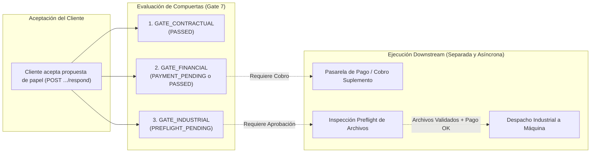

# BUDGET-02D-00 — Auditoría de Compuertas Financieras e Industriales Desacopladas

**Proyecto:** PrintPrice OS  
**Misión:** BUDGET-02D-00 — Auditoría Integral de Integración E2E  
**Estado:** AUDIT ONLY — READ ONLY  
**Referencia Certificada:** `744bdd89676c92de2c612152e1be58fe48698fd9`  

---

## 1. Modelo de Compuertas Triples Desacopladas

El diseño arquitectónico de PrintPrice OS para BUDGET-02C establece una separación infranqueable entre la voluntad contractual del cliente, la liquidación económica y la autorización industrial de fabricación.



---

## 2. Reconstrucción de Transiciones y Persistencia Real

### 2.1 Código Fuente de Evaluación
En [orderQuoteRevisionService.js:1890-1896](file:///c:/Users/KIKE/Downloads/ppos-control-plane-phase-10-intelligence-layer/src/api/services/orderQuoteRevisionService.js#L1890-L1896):
```js
const gates = {
    gate_contractual: decision === 'ACCEPT' ? 'PASSED' : 'REJECTED',
    gate_financial: decision === 'ACCEPT' && deltaNet > 0 ? 'PAYMENT_PENDING' : 'PASSED',
    gate_industrial: 'PREFLIGHT_PENDING' // Never automatic!
};
```

### 2.2 Diagnóstico de Persistencia: ¿Columnas SQL o Datos Efímeros?
Se verificó el esquema de base de datos de la migración [168_phase196g_order_quote_revisions.sql](file:///c:/Users/KIKE/Downloads/ppos-control-plane-phase-10-intelligence-layer/migrations/168_phase196g_order_quote_revisions.sql) y de la tabla `orders`:

1. **Ausencia de Columnas Físicas**: Ni `order_quote_revisions` ni `orders` poseen las columnas `gate_contractual`, `gate_financial` o `gate_industrial`.
2. **Ubicación Real de Almacenamiento**:
   - Se devuelven en el cuerpo JSON de la respuesta HTTP (`result.gates`).
   - Se serializan dentro del campo `payload_json` de la tabla `order_revision_audit_events`.
3. **Consecuencia Arquitectónica**:
   - **No existe estado consultable por SQL indexado**. Un servicio downstream no puede ejecutar `SELECT * FROM order_quote_revisions WHERE gate_financial = 'PASSED'` sin parsear blobs JSON de eventos de auditoría.
   - La persistencia es meramente forense/histórica, no operativa.

---

## 3. Verificación de Invariantes de Seguridad Financiera e Industrial

Se auditó el flujo para verificar que ninguna aceptación contractual desencadene acciones industriales o monetarias irreversibles de manera automática.

| Invariante Exigido | Comportamiento en Código | ¿Cumplimiento Verificado? | Evidencia en Código |
|---|---|---|---|
| **Cero Cargo Automático No Autorizado** | No se invoca ningún webhook de Stripe ni cobro bancario directo durante la aceptación. Si $\Delta \text{Neto} > 0$, el estado queda en `PAYMENT_PENDING`. | **SÍ (Cumplido)** | [orderQuoteRevisionService.js:1893](file:///c:/Users/KIKE/Downloads/ppos-control-plane-phase-10-intelligence-layer/src/api/services/orderQuoteRevisionService.js#L1893) |
| **Cero Facturación No Validada** | No se emite factura rectificativa automáticamente. Se delega al módulo de billing posterior. | **SÍ (Cumplido)** | Cero llamadas a `billingService` en `respondToQuoteRevision`. |
| **Cero Reserva Irreversible de Capacidad** | No se bloquea slot de producción en taller sin confirmación del pago. | **SÍ (Cumplido)** | El estado industrial permanece en `PREFLIGHT_PENDING`. |
| **Cero Consumo de Inventario de Papel** | No se confirma orden de compra al proveedor de papel (`supplier_paper_procurement_orders`) en esta fase. | **SÍ (Cumplido)** | Requiere acción de operario de compras. |
| **Cero Orden de Fabricación Automática** | La máquina de impresión no recibe la orden de trabajo al momento del consentimiento. | **SÍ (Cumplido)** | Exige paso por `MarketplaceDispatchGatingService`. |
| **Cero Despacho Industrial Prematuro** | El despacho a planta está explícitamente bloqueado hasta que los archivos pasen preflight y el pedido esté pagado. | **SÍ (Cumplido)** | [MarketplaceDispatchGatingService.js:29-47](file:///c:/Users/KIKE/Downloads/ppos-control-plane-phase-10-intelligence-layer/src/api/services/MarketplaceDispatchGatingService.js#L29-L47) |

---

## 4. Auditoría de Casos Económicos Especiales

### 4.1 Delta Positivo ($\Delta \text{Neto} > 0$)
- **Tratamiento**: Requiere consentimiento explícito y OTP (si $> 50$ €).
- **Compuerta Financiera**: Pasa a `PAYMENT_PENDING`.
- **Integración Downstream**: El cliente debe abonar la diferencia en la pasarela de pagos antes de que `invoice_payment.payment_status` cambie a `PAID`.

### 4.2 Delta Cero ($\Delta \text{Neto} = 0.0000$)
- **Tratamiento**: El taller propone un papel alternativo equivalente sin coste adicional (ej. cambio de marca de igual gramaje).
- **Compuerta Financiera**: Pasa inmediatamente a `PASSED` sin requerir transacción monetaria ni OTP.

### 4.3 Defecto Crítico: Delta Negativo ($\Delta \text{Neto} < 0$) y Vacío Financiero
- **Tratamiento en Código**: Cuando la propuesta sustituye un papel caro por uno más económico, el cliente tiene derecho a un reembolso.
- **Comportamiento Actual**:
  ```js
  gate_financial: decision === 'ACCEPT' && deltaNet > 0 ? 'PAYMENT_PENDING' : 'PASSED'
  ```
- **Fallo Detectado**: Al ser `deltaNet < 0`, la expresión evalúa a `PASSED`.
  - **No se genera orden de abono**.
  - **No se emite factura de abono/rectificativa**.
  - **No se dispara instrucción de reembolso en Stripe ni en transferencia bancaria**.
  - El sobrepago del cliente queda administrativamente atrapado sin mecanismo de devolución registrado.
- **Severidad**: **HIGH**.

---

## 5. La Brecha Crítica con el Despacho Industrial

Al inspeccionar [MarketplaceDispatchGatingService.js](file:///c:/Users/KIKE/Downloads/ppos-control-plane-phase-10-intelligence-layer/src/api/services/MarketplaceDispatchGatingService.js#L50-L70), se constató la mayor fractura de integración del sistema:

1. **Lectura de Especificaciones Obsoletas**:
   ```js
   let specs = {};
   try {
       specs = JSON.parse(order.specs || '{}');
   } catch (e) {}

   const packageData = {
       bookSpec: {
           interiorPaper: specs.interior_paper || '80gsm_white', ...
       }
   };
   ```
2. **Origen del Fallo**: Cuando el cliente acepta la revisión en `orderQuoteRevisionService.respondToQuoteRevision`, el servicio actualiza `order_quote_revisions` a `ACCEPTED`, **pero NUNCA actualiza el campo `specs` de la tabla `orders`**.
3. **Consecuencia Industrial**: Cuando el operario o el sistema lanza el despacho industrial a la máquina de imprimir, el paquete de fabricación se construye con el papel original (el que estaba agotado), enviando a taller una orden con material erróneo.
4. **Recomendación Obligatoria**: Al procesar la aceptación contractual (`status = 'ACCEPTED'`), `OrderQuoteRevisionService` debe emitir una mutación sincronizada o un evento de dominio que actualice `orders.specs` y `marketplace_orders.book_spec_json` con la variante aceptada por el cliente.
