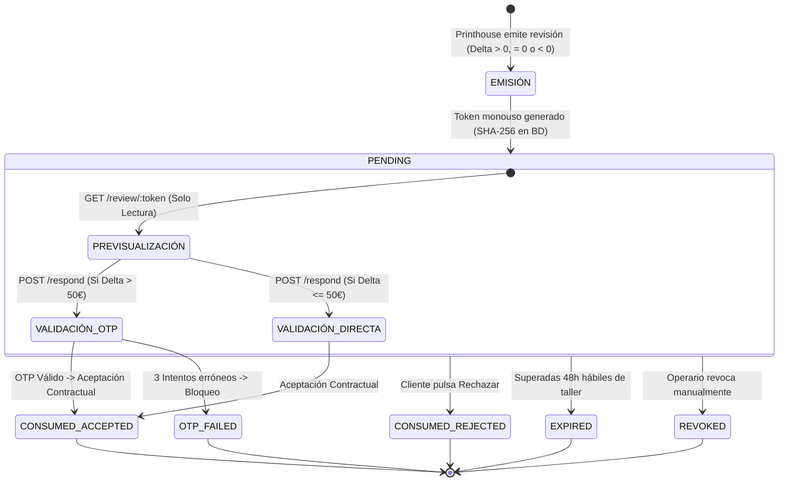

# BUDGET-02D-00 — Auditoría de Seguridad, Consentimiento y Superficie de Riesgo

**Proyecto:** PrintPrice OS  
**Misión:** BUDGET-02D-00 — Auditoría Integral de Integración E2E  
**Estado:** AUDIT ONLY — READ ONLY  
**Referencia Certificada:** `744bdd89676c92de2c612152e1be58fe48698fd9`  

---

## 1. Ciclo de Vida del Consentimiento del Cliente

El flujo de consentimiento del cliente para autorizar cambios de especificación técnica y precio revisado comprende cuatro etapas secuenciales:



---

## 2. Análisis Criptográfico y Gestión de Tokens

### 2.1 Generación y Almacenamiento
- **Entropía**: Generado con `crypto.randomBytes(32).toString('hex')` (256 bits de aleatoriedad criptográfica CSPRNG).
- **Cero Texto Plano en Base de Datos**: El token crudo solo viaja en la URL enviada al cliente. En la tabla `quote_revision_tokens` únicamente se persiste su hash SHA-256 (`token_hash`) y un prefijo público para identificación en logs.
- **Búsqueda Segura**: Las consultas en BD se realizan contra `WHERE token_hash = ?`, impidiendo fugas masivas en caso de volcado no autorizado de la base de datos.

### 2.2 Seguridad contra Ataques de Repetición y Fuerza Bruta
- **Monouso Estricto**: Al enviar una respuesta válida (`POST .../respond`), el token pasa atómicamente a `status = 'CONSUMED'`. Cualquier intento posterior de reutilización arroja `HTTP 410 TOKEN_ALREADY_CONSUMED`.
- **Límite de Intentos (Rate Limiting por Token)**: Se controla mediante `attempt_count` en BD con un máximo de 5 intentos (`max_attempts = 5`). Superado este límite, el token se marca como `REVOKED` arrojando `HTTP 429 MAX_ATTEMPTS_EXCEEDED`.
- **Inmunidad a Prefetching / Web Crawlers**: El endpoint de previsualización `GET /quote-revisions/review/:token` es de **solo lectura absoluta**. No altera contadores ni consume el token, protegiendo al cliente contra la invalidación accidental provocada por antivirus de correo, bots de indexación o navegadores con pre-renderizado.

---

## 3. Reto Anti-Fraude y Despacho OTP

Para diferenciales económicos donde el cliente deba asumir un sobrecoste superior a 50,00 € (`deltaNet > 50.00`), el sistema activa obligatoriamente un segundo factor de autenticación:

1. **Generación de OTP**: Código numérico de 6 dígitos generado con `crypto.randomInt(100000, 1000000)`.
2. **Hash con Sal**: Se almacena en BD como `sha256(code + ':' + salt + ':' + revisionId)`.
3. **Caducidad Corta**: TTL estricto de 15 minutos (`otp_expires_at`).
4. **Intentos Acotados**: Máximo 3 intentos de verificación de código OTP (`otp_max_attempts = 3`).
5. **Comportamiento Fail-Closed**:
   - En [orderQuoteRevisionService.js:1456-1468](file:///c:/Users/KIKE/Downloads/ppos-control-plane-phase-10-intelligence-layer/src/api/services/orderQuoteRevisionService.js#L1456-L1468), si el servicio no tiene configurado un proveedor real de correo (`sendMail`) o SMS (`sendOtp`), la creación de la revisión se **bloquea inmediatamente** (`OTP_DELIVERY_UNAVAILABLE`, 403).
   - En producción, esto previene la emisión de revisiones con coste sin canal de entrega garantizado, pero bloquea el flujo si la variable de entorno del transportador no ha sido inyectada.

---

## 4. Vulnerabilidad Crítica: Supervivencia de Consentimiento a Cambios del Pedido

Durante la auditoría de [OrderQuoteRevisionService.respondToQuoteRevision](file:///c:/Users/KIKE/Downloads/ppos-control-plane-phase-10-intelligence-layer/src/api/services/orderQuoteRevisionService.js#L1700-L1910), se identificó un fallo de gobierno de consentimiento de severidad crítica:

### 4.1 Mecánica del Defecto
Cuando el cliente invoca `POST /quote-revisions/review/:token/respond`, la función ejecuta la siguiente consulta para recuperar el contexto:
```sql
SELECT t.id AS token_id, t.token_hash, t.status AS token_status, t.expires_at, 
       r.id AS revision_id, r.status AS revision_status, r.delta_net_amount, ...
FROM quote_revision_tokens t
INNER JOIN order_quote_revisions r ON t.revision_id = r.id
WHERE t.token_hash = ? FOR UPDATE
```
**En ningún momento se consulta ni se bloquea la fila del pedido padre (`orders` o `marketplace_orders`).**

### 4.2 Escenarios de Explotación Operativa
1. **Cancelación Concurrente**: El cliente o un administrador cancela el pedido en la plataforma (estado `CANCELLED`). El cliente abre el enlace de correo previamente recibido y pulsa "Aceptar". La función procesa la aceptación, marca la revisión como `ACCEPTED`, consume el token y emite el evento de auditoría `REVISION_ACCEPTED` sobre un pedido legalmente cancelado.
2. **Reasignación de Imprenta**: Si la plataforma reasigna el pedido a un segundo taller (ej. Taller B) por saturación del Taller A, la revisión pendiente emitida por el Taller A puede seguir siendo aceptada por el cliente si el token no caducó. Esto deja dos talleres en conflicto sobre un único pedido.
3. **Modificación de Especificaciones**: Si el cliente modifica los archivos de producción o el número de páginas, la revisión de papel calculada para el formato anterior puede ser aceptada posteriormente sin invalidación automática.

### 4.3 Recomendación de Remediación
El método `respondToQuoteRevision` debe bloquear y verificar el pedido padre antes de alterar el estado de la revisión:
```sql
SELECT status, assigned_printhouse_id FROM orders WHERE id = ? FOR UPDATE
```
Si el estado del pedido no es elegible (`CANCELLED`, `CLOSED`, `REASSIGNED`), la aceptación debe ser rechazada con `409 ORDER_STATE_CONFLICT`.

---

## 5. Exposición de Rutas de Intranet y Confusión de Perímetro

### 5.1 Hallazgo
Las rutas de revisión del cliente están montadas físicamente en:
- `GET  /api/printhouse/quote-revisions/review/:token`
- `POST /api/printhouse/quote-revisions/review/:token/respond`

### 5.2 Riesgos de Seguridad Asociados
1. **Ruptura de Modelo de Acceso**: La ruta `/api/printhouse/*` está destinada operativamente a talleres e imprentas. Los gateways o cortafuegos de aplicación web (WAF) suelen aplicar políticas de filtrado IP o requerir certificados mTLS en prefijos de backoffice de imprenta. Un cliente final navegando desde un dispositivo móvil doméstico puede ser bloqueado en el perímetro de red antes de alcanzar el servicio.
2. **Confusión en Budget App**: La aplicación del cliente y la documentación oficial esperan que las llamadas se realicen a `/api/marketplace/quote-revisions/*`. Si se invoca esta ruta, Fastify devuelve `HTTP 404 Endpoint not found`.

---

## 6. Registro Forense de Consentimiento

Cada respuesta del cliente genera un registro de auditoría inmutable en `order_revision_audit_events`:
```json
{
  "decision": "ACCEPT",
  "responded_at": "2026-10-27T21:40:00.000Z",
  "client_ip_hash": "a591a6d40bf420404a011733cfb7b190d62c65bf0bcda32b57b277d9ad9f146e",
  "user_agent_hash": "e3b0c44298fc1c149afbf4c8996fb92427ae41e4649b934ca495991b7852b855",
  "verified_via": "VERIFIED_OTP"
}
```
Se preserva la privacidad del cliente mediante hashing criptográfico de la dirección IP y la cadena User-Agent, garantizando al mismo tiempo la no-repudiación y el cumplimiento del RGPD.
