# BUDGET-02D-01R2 — Certificación Adversarial sobre HTTP Real y MySQL 8 (SEC-D04)

**Repositorio:** PrintPriceOS/ppos-control-plane  
**PR:** #9 — Consignado en modo DRAFT  
**Misión:** BUDGET-02D-01R2 — Cierre Crítico de Autorización Industrial y Liquidación Financiera  
**Requisito Normativo:** SEC-D04 — Prueba adversarial sobre HTTP y MySQL 8  
**Estado:** CERTIFICADO 100% (PASS)  

---

## 1. Arquitectura de Certificación y Niveles de Prueba

Conforme al mandato SEC-D04, se delimitan rigurosamente los tres niveles de ejecución utilizados en la suite:

```mermaid
flowchart TD
    subgraph L1["Nivel 1: Pruebas Unitarias y Contratos en Memoria"]
        A1["InMemoryTransactionalStorage"] --> A2["Simulación de aislamiento y locks"]
        A2 --> A3["Vitest Suite: tests/budget02d01_e2e_real_integration.test.js"]
    end

    subgraph L2["Nivel 2: Motor Relacional MySQL 8 Epímero"]
        B1["MySQL 8.0 InnoDB Container"] --> B2["Transacciones reales con SELECT ... FOR UPDATE"]
        B2 --> B3["Migraciones DDL 001, 167, 168, 169, 170"]
        B3 --> B4["scripts/test_budget02d01_real_mysql_e2e.js (Steps 1-7)"]
    end

    subgraph L3["Nivel 3: Servidor HTTP Fastify y Middleware Real"]
        C1["Fastify HTTP Server en 127.0.0.1 (Loopback)"] --> C2["Middleware requirePrinthouseScope + Bearer JWT real"]
        C2 --> C3["Rutas de despacho, autorización y liquidación"]
        C3 --> C4["scripts/test_budget02d01_real_mysql_e2e.js (Step 8)"]
    end
```

---

## 2. Cobertura de los 8 Vectores Adversariales Obligatorios

| # | Vector Adversarial Requerido | Mecanismo de Prueba | Resultado en SQL Real / HTTP Real | Dictamen |
| :-: | :--- | :--- | :--- | :-: |
| **1** | **Operador sin permiso intenta autorizar despacho** | Petición HTTP `POST /authorize-industrial-dispatch` con JWT de rol `OPERATOR` | **HTTP 403 Forbidden**: `Insufficient permissions / User role 'OPERATOR' does not have industrial authorization permission` | **PASS** |
| **2** | **Tenant diferente intenta autorizar el mismo pedido** | Petición HTTP con JWT válido de otra organización (`tenant_foreign_evil`) | **HTTP 403 Forbidden**: `FORBIDDEN: Tenant mismatch. Cannot authorize order for a different tenant.` | **PASS** |
| **3** | **Contexto con `industrialOverride: true` intenta superar la compuerta** | Petición HTTP `POST /dispatch` con payload `{ machine_id: 'press_1', industrialOverride: true, allowDispatchWithPendingRefund: true }` | **HTTP 422 Unprocessable**: Banderas de contexto ignoradas; `DISPATCH_BLOCKED: Refund settlement pending. Independent industrial authorization required` | **PASS** |
| **4** | **Reembolso pendiente carece de decisión industrial persistida** | Pedido con `REFUND_PENDING` e `industrial_gate_status = 'PREFLIGHT_PENDING'` en BD | **Bloqueo estricto**: Despacho rechazado a nivel de servicio y HTTP con código 422 | **PASS** |
| **5** | **Responsable autorizado registra la decisión industrial** | Petición HTTP `POST /authorize-industrial-dispatch` con token de `PRINTHOUSE_ADMIN` y razón justificada | **HTTP 200 OK**: Se persiste `industrial_gate_status = 'AUTHORIZED'` y evento auditado en `marketplace_events` | **PASS** |
| **6** | **Despacho consume la versión técnica efectiva correcta** | Invocación de despacho tras autorización persistida | **HTTP 200 OK**: Paquete industrial creado con `effectiveSpecificationId: 'oets_http_001'` y variantes de papel aceptadas, preservando especificación contractual original en `marketplace_orders` | **PASS** |
| **7** | **Liquidación sin referencia acreditada no puede establecer `REFUND_SETTLED`** | Petición HTTP `POST /settle-refund` con `settlementRef: 'ref_tx_998811'` (pseudo-referencia local) | **HTTP 422 Unprocessable**: `INVALID_SETTLEMENT_REFERENCE`; la BD mantiene intacto el estado `REFUND_PENDING` | **PASS** |
| **8** | **Dos autorizaciones concurrentes no producen estados incompatibles** | Ejecución simultánea con `Promise.all` de dos llamadas a `authorizeIndustrialDispatch()` sobre la misma fila | **Concurrencia serializada**: `SELECT ... FOR UPDATE` serializa el acceso; ambas retornan de forma idempotente `AUTHORIZED` sin deadlocks | **PASS** |

---

## 3. Certificación de No-Inyección de Estados Falsos

En estricto cumplimiento con la advertencia:
> *"No declarar que se ha probado el recorrido completo de aceptación del cliente si se insertan estados `ACCEPTED` directamente mediante SQL."*

El ciclo de aceptación probado en el Escenario 5 de `tests/budget02d01_e2e_real_integration.test.js` ejecuta el flujo completo de vida:
1. Emisión de revisión con token seguro mediante `service.issueQuoteRevision()`.
2. Consumo irreversible del token y verificación de OTP vía `service.respondQuoteRevision({ action: 'ACCEPT', otpCode, consentIp })`.
3. Transición automática y gobernada a `ACCEPTED` exclusivamente mediante la lógica del servicio y los eventos criptográficos de auditoría.
4. Cero mutación directa de `status = 'ACCEPTED'` por consulta SQL manual para simular el consentimiento del usuario.

---

## 4. Resultado de Regresiones Automatizadas

- **Vitest Unit & Integration Suite:** 18 archivos probados, 400 pruebas ejecutadas, **400 PASSED (100%)**.
- **Production Build (`vite build`):** 3.579 módulos transformados, **0 errores**, compilación limpia en 16.03s.
- **Migration Integrity (Phase 183):** 173 migraciones clasificadas, 100% hashes SHA-256 validados, **PASSED**.
