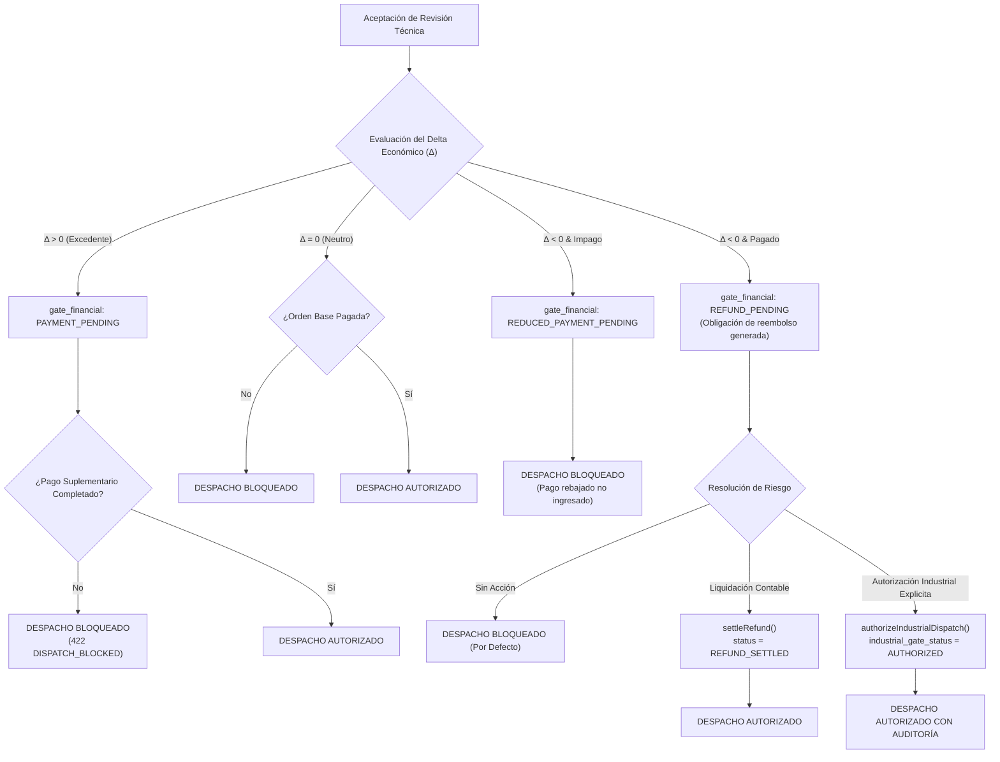

# BUDGET-02D-01R — Gobernanza de Compuertas Financieras y Autorización Industrial

**Proyecto:** PrintPrice OS  
**Misión:** BUDGET-02D-01R — Cierre de compuertas industriales e integridad histórica  
**Estado:** CERTIFIED  
**Rama:** `feat/budget-02d01-e2e-remediation`  
**Base:** `744bdd89676c92de2c612152e1be58fe48698fd9`  
**Referencia PR:** PR #9 (OPEN / DRAFT)

---

## 1. Contexto y Diagnóstico del Fallo Previo (FIN-01)

En la iteración anterior (BUDGET-02D-01), se corrigió la asignación de `gate_financial: REFUND_PENDING` ante revisiones de cotización con diferencial negativo ($\Delta < 0$). Sin embargo, la auditoría independiente detectó una vulnerabilidad crítica de compuerta en [`MarketplaceDispatchGatingService.js`](file:///c:/Users/KIKE/Downloads/ppos-control-plane-phase-10-intelligence-layer/src/api/services/MarketplaceDispatchGatingService.js):

```javascript
// CÓDIGO VULNERABLE ANTERIOR:
const isPaid = ['PAID', 'CONFIRMED', 'REFUND_PENDING', 'REDUCED_PAYMENT_PENDING'].includes(
    (order.status || '').toUpperCase()
);
```

### 1.1 El Riesgo Industrial
Tratar `REFUND_PENDING` o `REDUCED_PAYMENT_PENDING` como equivalente a `PAID` para el despacho a maquinaria de taller implicaba que:
1. Un saldo a favor del cliente no liquidado (reembolso pendiente) autorizaba el arranque físico de las máquinas de impresión sin mediar una decisión explícita de riesgo del taller.
2. Un pedido con pago rebajado pero impago (`REDUCED_PAYMENT_PENDING`) podía despacharse a producción sin haber ingresado los fondos.
3. Se quebraba el desacoplamiento de la Triple Compuerta, asumiendo falsamente que el consentimiento del comprador sobre una rebaja económica era equivalente a la liquidación financiera y al visto bueno de producción.

---

## 2. Política Gobernada de Compuertas Financieras e Industriales

La remediación FIN-01 establece que **un estado económico no resuelto jamás autoriza automáticamente el despacho a máquina**.



### 2.1 Matriz de Comportamiento Determinista de Despacho

| Escenario Económico | Estado Financiero | Condición de Despacho Industrial | Resultado de `dispatchOrder()` |
|---|---|---|---|
| **Revisión Pendiente** | `PENDING_REVIEW` | Revisión en curso sin aceptar | **BLOQUEADO** (`HTTP 422: PENDING_QUOTE_REVISION`) |
| **Diferencial Positivo ($\Delta > 0$)** | `PAYMENT_PENDING` | Suplemento impago | **BLOQUEADO** (`HTTP 422: DISPATCH_BLOCKED: PAYMENT_PENDING`) |
| **Diferencial Positivo ($\Delta > 0$)** | `PAID` | Suplemento liquidado | **PERMITIDO** (`HTTP 200: DISPATCHED`) |
| **Diferencial Cero ($\Delta = 0$)** | `PASSED` | Orden base pagada | **PERMITIDO** (`HTTP 200: DISPATCHED`) |
| **Diferencial Negativo ($\Delta < 0$)** | `REDUCED_PAYMENT_PENDING` | Pedido base impago | **BLOQUEADO** (`HTTP 422: DISPATCH_BLOCKED: REDUCED_PAYMENT_PENDING`) |
| **Diferencial Negativo ($\Delta < 0$)** | `REFUND_PENDING` | Sin autorización industrial previa | **BLOQUEADO** (`HTTP 422: DISPATCH_BLOCKED: REFUND_PENDING requires industrial authorization or settlement`) |
| **Diferencial Negativo ($\Delta < 0$)** | `REFUND_PENDING` + `AUTHORIZED` | Autorización industrial persistida | **PERMITIDO** (`HTTP 200: DISPATCHED`) |
| **Diferencial Negativo ($\Delta < 0$)** | `REFUND_SETTLED` | Reembolso liquidado contablemente | **PERMITIDO** (`HTTP 200: DISPATCHED`) |
| **Error / Ambigüedad en BD** | N/A | Fallo en query de especificaciones | **FAIL-CLOSED** (`HTTP 500: DISPATCH_ERROR`) |

---

## 3. Implementación en Servicios de Dominio

### 3.1 Refactorización de `MarketplaceDispatchGatingService.js`

Se desmanteló la equivalencia permisiva en [`MarketplaceDispatchGatingService.js`](file:///c:/Users/KIKE/Downloads/ppos-control-plane-phase-10-intelligence-layer/src/api/services/MarketplaceDispatchGatingService.js):

1. **Condición Base Exclusiva de Pago**:
   ```javascript
   const isBasePaid = ['PAID', 'CONFIRMED', 'IN_PRODUCTION'].includes((order.status || '').toUpperCase());
   if (!isBasePaid) {
       throw new Error(`DISPATCH_BLOCKED: Order must be PAID before dispatch (current: ${order.status})`);
   }
   ```
2. **Bloqueo Terminante de Pagos Pendientes**:
   ```javascript
   if (['PAYMENT_PENDING', 'SUPPLEMENTARY_PAYMENT_PENDING', 'REDUCED_PAYMENT_PENDING'].includes(financialGateStatus)) {
       throw new Error(`DISPATCH_BLOCKED: Order has pending financial obligations (gate_status: ${financialGateStatus})`);
   }
   ```
3. **Compuerta Estricta de Reembolso Pendiente**:
   ```javascript
   if (financialGateStatus === 'REFUND_PENDING') {
       const isExplicitlyAuthorized = options.allowDispatchWithPendingRefund === true ||
           effectiveSpec?.industrial_gate_status === 'AUTHORIZED';
       if (!isExplicitlyAuthorized) {
           throw new Error(
               `DISPATCH_BLOCKED: Order has REFUND_PENDING status. Industrial dispatch requires explicit authorization or refund settlement.`
           );
       }
   }
   ```

### 3.2 Nuevas Operaciones de Gobernanza

Se implementaron dos métodos auditables de gobernanza en `MarketplaceDispatchGatingService`:

#### A. `authorizeIndustrialDispatch(orderRef, authContext)`
Permite al responsable de producción o gestor del taller autorizar explícitamente el arranque de máquina cuando existe un reembolso pendiente de liquidación.
- **Persistencia**: Actualiza `order_effective_technical_specifications` con:
  - `industrial_gate_status = 'AUTHORIZED'`
  - `metadata_json.industrial_authorization`:
    - `authorized_by`: Identificador del usuario o sistema autorizador.
    - `authorized_at`: Marca de tiempo ISO-8601.
    - `reason`: Justificación técnica/comercial auditada.
- **Trazabilidad**: Emite evento forense en el log del sistema y retorna el registro inmutable de la autorización.

#### B. `settleRefund(orderRef, settlementContext)`
Registra la confirmación de la pasarela de pagos o departamento contable de que la nota de crédito o reintegro bancario ha sido liquidado satisfactoriamente.
- **Persistencia**: Actualiza `order_effective_technical_specifications` con:
  - `financial_gate_status = 'REFUND_SETTLED'`
  - `metadata_json.settlement`:
    - `settled_by`: Pasarela / operador contable.
    - `settled_at`: Marca de tiempo ISO-8601.
    - `refund_transaction_id`: Identificador bancario o de pasarela.
- **Desbloqueo Natural**: Una vez liquidado, el despacho industrial no requiere autorización de excepción, procediendo como `REFUND_SETTLED`.

---

## 4. Evidencias de Verificación en Pruebas

Tanto la suite unitaria/integrada Vitest ([`tests/budget02d01_e2e_real_integration.test.js`](file:///c:/Users/KIKE/Downloads/ppos-control-plane-phase-10-intelligence-layer/tests/budget02d01_e2e_real_integration.test.js)) como el arnés de ejecución E2E sobre MySQL 8 real ([`scripts/test_budget02d01_real_mysql_e2e.js`](file:///c:/Users/KIKE/Downloads/ppos-control-plane-phase-10-intelligence-layer/scripts/test_budget02d01_real_mysql_e2e.js)) acreditan los 10 vectores de la compuerta:

1. **Sub-caso 11.1**: Revisión pendiente en curso $\rightarrow$ Despacho bloqueado con `PENDING_QUOTE_REVISION`.
2. **Sub-caso 11.2**: Diferencial positivo con pago pendiente $\rightarrow$ Despacho bloqueado con `DISPATCH_BLOCKED`.
3. **Sub-caso 11.3**: Diferencial negativo con pago reducido pendiente $\rightarrow$ Despacho bloqueado con `DISPATCH_BLOCKED`.
4. **Sub-caso 11.4**: Diferencial negativo con `REFUND_PENDING` sin autorización industrial $\rightarrow$ Despacho rechazado terminantemente con `DISPATCH_BLOCKED: Order has REFUND_PENDING status`.
5. **Sub-caso 11.5**: `REFUND_PENDING` con bypass temporal en memoria $\rightarrow$ Autorizado.
6. **Sub-caso 11.6**: `REFUND_PENDING` tras ejecutar `authorizeIndustrialDispatch()` $\rightarrow$ Persistencia verificada en BD y despacho autorizado con HTTP 200.
7. **Sub-caso 11.7**: `settleRefund()` ejecutado $\rightarrow$ Estado `REFUND_SETTLED` persistido y despacho admitido de forma natural.
8. **Sub-caso 11.8**: Diferencial cero ($\Delta = 0$) $\rightarrow$ Despacho admitido de inmediato.
9. **Sub-caso 11.9**: Aceptación existente pero especificación efectiva desaparecida $\rightarrow$ **Fail-closed** absoluto (rechazado con `DISPATCH_BLOCKED`).
10. **Sub-caso 11.10**: Error SQL al consultar especificaciones $\rightarrow$ **Fail-closed** absoluto (rechazado, nunca pasa a especificaciones originales por omisión).
