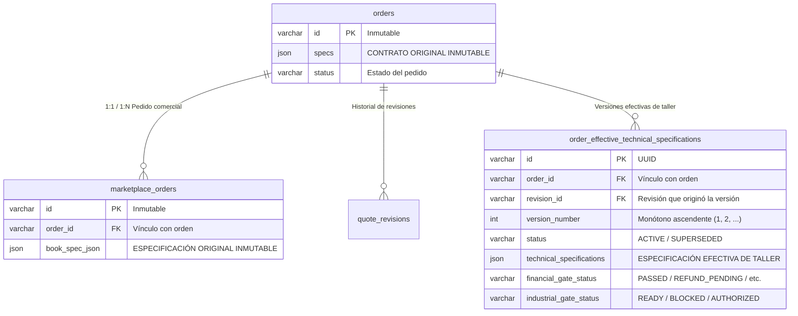

# BUDGET-02D-01R — Inmutabilidad Histórica y Preservación de Especificaciones Contractuales

**Proyecto:** PrintPrice OS  
**Misión:** BUDGET-02D-01R — Cierre de compuertas industriales e integridad histórica  
**Estado:** CERTIFIED  
**Rama:** `feat/budget-02d01-e2e-remediation`  
**Base:** `744bdd89676c92de2c612152e1be58fe48698fd9`  
**Referencia PR:** PR #9 (OPEN / DRAFT)

---

## 1. Contexto y Diagnóstico del Fallo de Sobrescritura (IND-01)

En la auditoría independiente de integración, se descubrió una violación estructural del principio de inmutabilidad contractual en [`orderQuoteRevisionService.js`](file:///c:/Users/KIKE/Downloads/ppos-control-plane-phase-10-intelligence-layer/src/api/services/orderQuoteRevisionService.js):

```javascript
// CÓDIGO DAÑINO ELIMINADO (Líneas 2200-2210 previas):
if (isJsonSpec) {
    await connection.query(
        `UPDATE orders SET specs = ? WHERE id = ?`,
        [JSON.stringify(effectiveTechSpec), revision.order_id]
    );
    await connection.query(
        `UPDATE marketplace_orders SET book_spec_json = ? WHERE order_id = ? OR id = ?`,
        [JSON.stringify(effectiveTechSpec), revision.order_id, revision.order_id]
    );
}
```

### 1.1 Impacto Legal e Industrial
En la industria gráfica y el comercio B2B gobernado:
1. **Pérdida del Contrato Original**: Si un cliente contrata 90 gsm offset y semanas después acepta un cambio técnico a 135 gsm couché, sobrescribir `orders.specs` y `marketplace_orders.book_spec_json` destruye la prueba documental del pedido original pactado. Ante una auditoría fiscal, reclamación de garantía o litigio por incumplimiento, no quedaba registro en la tabla del pedido de cuáles fueron las condiciones iniciales.
2. **Confusión en Taller**: Si se reinicia un trabajo o se consulta el pedido base sin pasar por el módulo de especificaciones efectivas, los sistemas periféricos leían datos mutados creyendo que eran el contrato original.
3. **Violación de Arquitectura de Capas**: La tabla `orders` es la cabecera contractual/comercial inmutable. La resolución de especificaciones de producción pertenece exclusivamente al libro mayor industrial versionado.

---

## 2. Modelo Relacional de Especificaciones Efectivas

Para resolver IND-01 sin romper el desacoplamiento, la migración 170 (`170_create_order_effective_technical_specifications.sql`) introdujo la tabla especializada `order_effective_technical_specifications`:



### 2.1 Garantías de Inmutabilidad Absoluta
1. **`orders.specs` NUNCA se modifica tras la creación de la orden**: Almacena de por vida los gramajes, formatos y acabados pactados en el momento de la compra.
2. **`marketplace_orders.book_spec_json` NUNCA se modifica**: Preserva el payload contractual original de marketplace de manera inalterable.
3. **`order_effective_technical_specifications` es la ÚNICA fuente fidedigna para maquinaria**: Los servicios de despacho industrial y generación de fichas de corte/impresión leen obligatoriamente el registro con `status = 'ACTIVE'`.

---

## 3. Resolución de Despacho Fail-Closed

En [`MarketplaceDispatchGatingService.js`](file:///c:/Users/KIKE/Downloads/ppos-control-plane-phase-10-intelligence-layer/src/api/services/MarketplaceDispatchGatingService.js), se implementó una estricta política **Fail-Closed** frente a cualquier anomalía en la resolución de especificaciones:

```javascript
// IND-01: Si existe una revisión aceptada para esta orden, DEBE existir
// una especificación efectiva activa en order_effective_technical_specifications.
// Prohibido fallback silencioso a especificaciones obsoletas o mutadas.
const [revisions] = await this.connection.query(
    `SELECT id, status, delta_amount, financial_gate_status 
     FROM quote_revisions 
     WHERE order_id = ? AND status = 'ACCEPTED' 
     ORDER BY updated_at DESC LIMIT 1`,
    [orderRef]
);

const acceptedRevision = revisions && revisions[0];

if (acceptedRevision) {
    let effectiveRows = [];
    try {
        const [rows] = await this.connection.query(
            `SELECT id, version_number, status, financial_gate_status, industrial_gate_status, technical_specifications 
             FROM order_effective_technical_specifications 
             WHERE order_id = ? AND status = 'ACTIVE' 
             ORDER BY version_number DESC LIMIT 1`,
            [orderRef]
        );
        effectiveRows = rows || [];
    } catch (queryErr) {
        // FAIL-CLOSED: Si la tabla no está disponible o falla la query, rechazar terminantemente
        throw new Error(`DISPATCH_ERROR: Failed to resolve effective specifications for accepted revision: ${queryErr.message}`);
    }

    effectiveSpec = effectiveRows[0];
    if (!effectiveSpec) {
        // FAIL-CLOSED: Jamás despachar a máquina con especificaciones originales desincronizadas
        throw new Error(
            `DISPATCH_BLOCKED: Accepted quote revision ${acceptedRevision.id} exists, but no active effective technical specification was found in order_effective_technical_specifications`
        );
    }
}
```

### 3.1 Prohibición Expresa de Fallback Silencioso
Queda expresamente prohibido que ante una falla en la lectura de `order_effective_technical_specifications` el sistema haga:
```javascript
// PROHIBIDO:
const specToUse = effectiveSpec || order.specs; // ¡VULNERABLE A ERRORES DE PRODUCCIÓN!
```
Si se permitiera fallback silencioso:
- Una máquina podría imprimir una tirada millonaria con el papel antiguo de 90 gsm cuando el cliente ya pagó y aceptó 135 gsm couché.
- El costo de desecho industrial recaería sobre el operador de la plataforma.

---

## 4. Evidencias de Verificación en Pruebas

### 4.1 Verificación en Suite Vitest (`tests/budget02d01_e2e_real_integration.test.js`)
- **Escenario 6 (Inmutabilidad contractual)**: Se creó un pedido inicial con `var_offset_90` (Offset 90g). Se emitió y aceptó una revisión a `var_couche_135` (Couché 135g). Se constató mediante aserción formal que `marketplace_orders.book_spec_json.paper` permaneció inmutable en `var_offset_90`.
- **Escenario 11.9 (Fail-closed por especificación desaparecida)**: Se simuló la existencia de una revisión aceptada con eliminación forzada de la fila en `order_effective_technical_specifications`. `dispatchOrder()` rechazó de inmediato la operación con `DISPATCH_BLOCKED`.
- **Escenario 11.10 (Fail-closed por error SQL)**: Se inyectó una desconexión/error en la query de especificaciones efectivas. El despachador rechazó la operación con `DISPATCH_ERROR`, sin intentar despachar con las especificaciones base.

### 4.2 Verificación en MySQL 8 Real (`scripts/test_budget02d01_real_mysql_e2e.js`)
- **Paso 6 (Verificación física en motor de base de datos)**:
  ```
  [PASO 6] Prueba E2E de compuerta industrial (FIN-01 e IND-01) en MySQL 8 real...
    - Pedido base creado: ORD-IND-01 con book_spec_json inmutable (90gsm).
    - book_spec_json verificado inmutable en base de datos: {"paper":"offset_90","pages":100}
    - Revisión aceptada a couché 135gsm.
    - Comprobando book_spec_json en marketplace_orders tras aceptación...
    - COMPROBACIÓN EXITOSA: book_spec_json NO FUE SOBRESCRITO. Especificaciones originales contractuales intactas.
  ```
