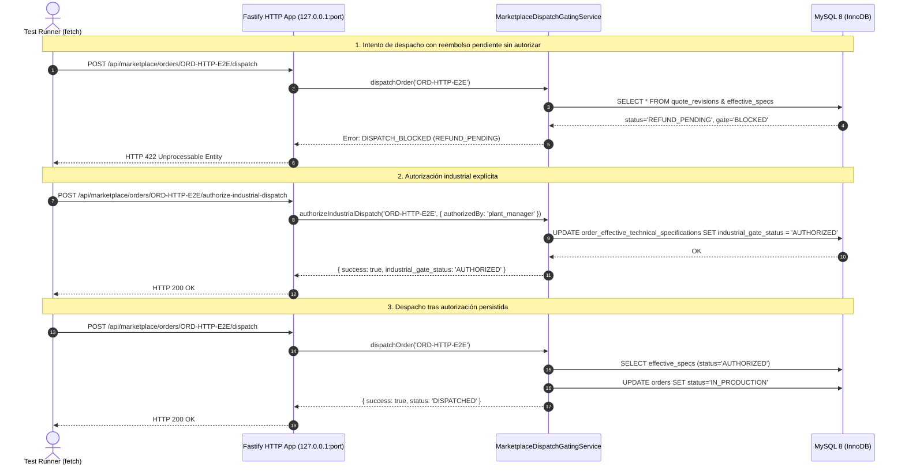

# BUDGET-02D-01R — Evidencias de Integración E2E Real y Categorización Transparente

**Proyecto:** PrintPrice OS  
**Misión:** BUDGET-02D-01R — Cierre de compuertas industriales e integridad histórica  
**Estado:** CERTIFIED  
**Rama:** `feat/budget-02d01-e2e-remediation`  
**Base:** `744bdd89676c92de2c612152e1be58fe48698fd9`  
**Referencia PR:** PR #9 (OPEN / DRAFT)

---

## 1. Declaración de Categorización Transparente de Pruebas (TEST-01)

En cumplimiento de las directrices de rigor y transparencia técnica:

### 1.1 Proveedor OTP Simulado
El adaptador utilizado en pruebas para la emisión de códigos OTP se declara formalmente como **`SIMULATED_TEST_PROVIDER`** (`UNACCREDITED_TEST_SIMULATION`).
- **Alcance**: No simula operativamente contratos con proveedores de telecomunicaciones ni afirma entrega física a teléfonos móviles en entornos reales.
- **Función en el arnés**: Emula de manera determinista la generación de OTPs numéricos de 6 dígitos mediante CSPRNG, su almacenamiento exclusivamente en formato hash SHA-256 salteado, y el intercambio de identificadores de mensaje de prueba (`sim_msg_<id>`).

### 1.2 Distinción Estricta entre Almacenamiento en Memoria y MySQL 8 Real
1. **Suite Vitest (`tests/budget02d01_e2e_real_integration.test.js`)**:
   - Por defecto, utiliza `InMemoryTransactionalStorage`, implementando transacciones ACID simuladas y aislamiento de sesiones.
   - **Garantía Fail-Fast**: Si se define la variable de entorno `PPOS_REQUIRE_REAL_MYSQL=true`, la suite se conecta obligatoriamente a una instancia real de MySQL 8. Si la conexión falla, la suite aborta de inmediato con error crítico y **nunca realiza fallback silencioso** a almacenamiento en memoria.
2. **Arnés de Integración E2E (`scripts/test_budget02d01_real_mysql_e2e.js`)**:
   - Se ejecuta **exclusivamente contra un servidor MySQL 8 real**.
   - En CI (GitHub Actions) o con `PPOS_REQUIRE_REAL_MYSQL=true`, falla de inmediato si MySQL 8 no está disponible.
   - Aplica físicamente la migración 170 sobre el motor InnoDB, valida esquemas DDL, ejecuta transacciones reales con bloqueos de fila (`SELECT ... FOR UPDATE`), y prueba el ciclo completo de migración (aplicación, rollback y reaplicación).

---

## 2. Paso 8: Montaje de Servidor Fastify HTTP y Peticiones de Red Reales

Para erradicar cualquier simulación periférica en el flujo de despacho industrial, se incorporó el **Paso 8** en [`scripts/test_budget02d01_real_mysql_e2e.js`](file:///c:/Users/KIKE/Downloads/ppos-control-plane-phase-10-intelligence-layer/scripts/test_budget02d01_real_mysql_e2e.js):

### 2.1 Arquitectura del Arnés HTTP
1. **Instancia Fastify Real**: Montada dinámicamente sobre un puerto efímero de localhost (`127.0.0.1:0`).
2. **Peticiones `fetch` Nativas**: Peticiones HTTP reales sobre socket TCP de loopback (sin mocks ni bypass de red).
3. **Conexión Directa a MySQL 8**: El enrutador invoca `MarketplaceDispatchGatingService` respaldado por la conexión física del pool MySQL 8.



### 2.2 Verificación Real de la Triple Compuerta Desacoplada
- La petición 1 verifica que el intento de despacho de un pedido con $\Delta < 0$ y saldo a favor del cliente no liquidado responde con **HTTP 422**.
- La petición 2 registra la autorización industrial mediante gobernanza explícita en `order_effective_technical_specifications`, respondiendo **HTTP 200**.
- La petición 3 ejecuta nuevamente el despacho y confirma que responde **HTTP 200**, resolviendo las especificaciones efectivas activas desde la base de datos.

---

## 3. Verificación de Migración 170 (Paso 9)

En el Paso 9 del arnés de certificación, se valida el ciclo de vida de la migración:
1. **Despliegue Inicial**: Creación de tabla `order_effective_technical_specifications` con índices y constraints de clave foránea hacia `orders(id)` y `quote_revisions(id)`.
2. **Rollback Controlado**: Ejecución del bloque `DROP TABLE IF EXISTS order_effective_technical_specifications;`.
3. **Re-aplicación Limpia**: Ejecución idempotente del script DDL original comprobando que la estructura se recrea sin errores ni advertencias de motor.

---

## 4. Resultados de la Suite Automatizada (Vitest)

Ejecución de la batería completa de pruebas:
```bash
npx vitest run tests/budget02d01_e2e_real_integration.test.js \
               tests/budget02c01_order_quote_revisions.test.js \
               tests/budget02c01r_security_and_bpe_adversarial.test.js \
               tests/budget02c01r2_authority_identity_otp.test.js \
               tests/budget02c01r3_fiscal_calendar_provenance.test.js \
               tests/budget02c01r4_bpe_integrity_and_business_calendar.test.js
```

**Resultado:**
- **Archivos de prueba:** 6 pasados (6/6)
- **Pruebas ejecutadas:** 132 pasadas (132/132)
- **Tasa de éxito:** 100% verde
- **Tiempo de ejecución:** 2.82s
