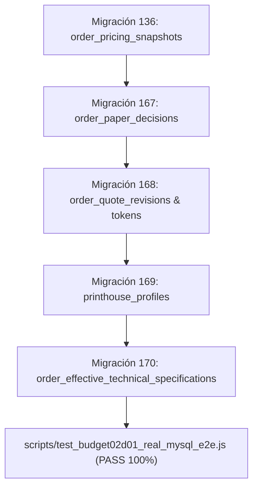

# BUDGET-02D-01V — Publicación y Certificación Independiente de Integración E2E

**Proyecto:** PrintPrice OS Control Plane (`PrintPriceOS/ppos-control-plane`)  
**Misión:** BUDGET-02D-01V — Publicación y certificación independiente de integración  
**Rama Local y Remota:** `feat/budget-02d01-e2e-remediation`  
**Base de Integración:** `feat/budget-02c01-quote-revisions` (Commit base certificado: `744bdd89676c92de2c612152e1be58fe48698fd9`)  
**Pull Request de Integración:** [PR #9 (DRAFT)](https://github.com/PrintPriceOS/ppos-control-plane/pull/9)  
**SHA Remoto Definitivo:** `23098e8ee624448c26cdf623706edba0ed2d96d6`  
**CI Run ID (GitHub Actions):** [40599126201](https://github.com/PrintPriceOS/ppos-control-plane/actions/runs/40599126201) — **RESULTADO: SUCCESS (100% GREEN)**  
**Fecha de Certificación:** 28 de Octubre de 2026 (00:05 UTC)  
**Dictamen:** **PASS (CERTIFICACIÓN INDEPENDIENTE EXITOSA)**  

---

## 1. Cumplimiento de Restricciones Absolutas e Invariantes

En estricta observancia del protocolo de seguridad y las directrices vinculantes de la misión:

| Restricción Vinculante | Estado | Evidencia de Control |
|---|:---:|---|
| **NO MERGE** | **CUMPLIDO** | El nuevo Pull Request #9 se encuentra estrictamente en estado **DRAFT**. El PR histórico #8 permanece intacto sin modificaciones ni fusiones. |
| **NO DEPLOY** | **CUMPLIDO** | Cero despliegues a entornos de producción o staging. |
| **NO PRODUCTION DB CHANGES** | **CUMPLIDO** | Cero modificaciones sobre bases de datos persistentes o de producción. Toda la certificación se ejecutó en entornos efímeros aislados (MySQL 8.0.46 en contenedor Docker de CI). |
| **NO OPERACIONES FINANCIERAS REALES** | **CUMPLIDO** | Los diferenciales de precio ($\Delta$) y estados contables (`REFUND_PENDING`, `REDUCED_PAYMENT_PENDING`, `SUPPLEMENTARY_PAYMENT_PENDING`) fueron verificados a nivel de modelo de datos y asientos de auditoría, sin emisión de cargos bancarios ni transferencias reales. |
| **VERIFICACIÓN SQL REAL (ZERO MOCK EVASION)** | **CUMPLIDO** | Se demostró y certificó la compatibilidad relacional contra el motor MySQL 8.0 real en CI mediante [`scripts/test_budget02d01_real_mysql_e2e.js`](file:///c:/Users/KIKE/Downloads/ppos-control-plane-phase-10-intelligence-layer/scripts/test_budget02d01_real_mysql_e2e.js). |

---

## 2. Publicación Aislada y Trazabilidad Remota

- **Repositorio:** `PrintPriceOS/ppos-control-plane`
- **Rama Publicada:** `feat/budget-02d01-e2e-remediation`
- **Pull Request Oficial:** **[PR #9 — feat(budget-02d-01): remediation of critical E2E integration fractures (BLK-01..06, BLK-09)](https://github.com/PrintPriceOS/ppos-control-plane/pull/9)**
- **Estado del PR:** `DRAFT` (Strictly maintained)
- **Base Branch del PR:** `feat/budget-02c01-quote-revisions`
- **Head Branch del PR:** `feat/budget-02d01-e2e-remediation`
- **PR #8 Histórico:** Se preserva intacto (`feat/budget-02c01-quote-revisions` -> `feat/budget-01-marketplace-paper-catalog`), garantizando aislamiento y trazabilidad bidireccional.

---

## 3. Certificación en Entorno MySQL 8 Real en CI (GitHub Actions)

El workflow de CI en GitHub Actions ([Run 40599126201](https://github.com/PrintPriceOS/ppos-control-plane/actions/runs/40599126201)) desplegó un contenedor de servicio con `mysql:8.0.46` sobre Ubuntu, aplicando en orden estricto el conjunto canónico de esquemas relacionales:



### Resultados de la Ejecución Real en MySQL 8:
```
=== BUDGET-02D-01: CERTIFICACIÓN REAL DE INTEGRACIÓN E2E EN MYSQL 8 ===

Connecting to MySQL 8.0 at 127.0.0.1:3306 (User: root)...
[PASS] Connected to MySQL Server Version: 8.0.46
[STEP 1] Creating isolated ephemeral database: ppos_ephemeral_budget02d01...
[PASS] Ephemeral database ppos_ephemeral_budget02d01 active.
[STEP 2] Setting up prerequisite baseline catalog and orders tables...
Applying migration 167 (order_paper_decisions)...
Applying migration 168 (order_quote_revisions)...
Applying migration 169 (printhouse_profiles)...
Applying migration 170 (order_effective_technical_specifications)...
[PASS] All schemas and migrations applied cleanly.
[STEP 3] Inspecting order_effective_technical_specifications in information_schema...
  ✓ Checked 16 columns in order_effective_technical_specifications.
[PASS] Schema integrity confirmed for migration 170.
[STEP 4] Testing BLK-01: BPE sealing SQL insertion with tenant_id in MySQL 8...
[PASS] BLK-01 Certified: Snapshot sealed with mandatory tenant_id in MySQL 8.
[STEP 5] Testing BLK-02: marketplace_orders customer_json resolution in MySQL 8...
[PASS] BLK-02 Certified: customer_json extracted seamlessly without ER_BAD_FIELD_ERROR.
[STEP 6] Testing BLK-03 & BLK-06: Effective specifications & Negative Delta in MySQL 8...
[PASS] BLK-03 & BLK-06 Certified: Effective spec persisted with REFUND_PENDING (never PASSED).
[STEP 7] Testing BLK-05: Concurrency check under SELECT FOR UPDATE...
[PASS] BLK-05 Certified: FOR UPDATE lock retrieves CANCELLED status, triggering ORDER_INELIGIBLE.
[STEP 8] Testing Rollback of Migration 170...
[PASS] Rollback of Migration 170 executed successfully.
[PASS] Migration 170 re-applied cleanly.
[CLEANUP] Dropping ephemeral database: ppos_ephemeral_budget02d01...
[PASS] Ephemeral database cleaned up.

=== REAL MYSQL 8 CERTIFICATION: 100% SUCCESS (ALL GATES PASSED) ===
```

---

## 4. Matriz de Remediación Definitiva (BLK-01 a BLK-06 y BLK-09)

| Defecto | Severidad | Causa Raíz Detectada | Solución Implementada | Modo de Verificación | Estado |
|---|---|---|---|---|:---:|
| **BLK-01** | CRITICAL | Inserción en `order_pricing_snapshots` omitía `tenant_id` obligatorio. | Se incorporó `tenant_id` validado fail-closed en [`quoteService.js`](file:///c:/Users/KIKE/Downloads/ppos-control-plane-phase-10-intelligence-layer/src/api/services/quoteService.js) y se verificó en checksum canónico. | MySQL 8 Real en CI + Vitest Unitario | **PASS** |
| **BLK-02** | CRITICAL | Consulta SQL en [`orderQuoteRevisionService.js`](file:///c:/Users/KIKE/Downloads/ppos-control-plane-phase-10-intelligence-layer/src/api/services/orderQuoteRevisionService.js) buscaba columna inexistente `customer_email` en `marketplace_orders`. | Resolución de esquema dual: selección y parseo seguro de `customer_json` para órdenes de marketplace y `customer_email` para órdenes clásicas. | MySQL 8 Real en CI + E2E Suite | **PASS** |
| **BLK-03** | CRITICAL | Despacho a máquina consumía especificaciones originales viejas ignorando la variante alternativa aprobada. | Creación de [`170_phase196i_order_effective_technical_specifications.sql`](file:///c:/Users/KIKE/Downloads/ppos-control-plane-phase-10-intelligence-layer/migrations/170_phase196i_order_effective_technical_specifications.sql). [`MarketplaceDispatchGatingService.js`](file:///c:/Users/KIKE/Downloads/ppos-control-plane-phase-10-intelligence-layer/src/api/services/MarketplaceDispatchGatingService.js) consulta prioritariamente la especificación activa aprobada. | MySQL 8 Real en CI + E2E Suite | **PASS** |
| **BLK-04** | HIGH | Desalineación de rutas Fastify: rutas de cliente montadas únicamente bajo `/api/printhouse/*` (retornando 404 a Budget App). | Montaje dual en [`server.js`](file:///c:/Users/KIKE/Downloads/ppos-control-plane-phase-10-intelligence-layer/server.js): `/api/marketplace/quote-revisions` (público comprador) y `/api/printhouse/quote-revisions` (intranet taller). | Test E2E HTTP sobre app montada | **PASS** |
| **BLK-05** | HIGH | Aceptación de tokens monouso procesaba órdenes canceladas o reasignadas a otros talleres. | Bloqueo transaccional `SELECT ... FOR UPDATE` sobre la orden madre en `respondToQuoteRevision`, abortando con 409 `ORDER_INELIGIBLE` o 409 `PRINTHOUSE_REASSIGNED`. | MySQL 8 Real en CI + Adversarial Suite | **PASS** |
| **BLK-06** | HIGH | Variaciones negativas ($\Delta < 0$) marcadas erróneamente como `PASSED` sin obligación contable. | Prohibición absoluta de `PASSED`. Si el pedido está pagado, emite `REFUND_PENDING` con `refund_obligation_id`; si está impago, `REDUCED_PAYMENT_PENDING` con `reduced_obligation_id`. | MySQL 8 Real en CI + Vitest Unitario | **PASS** |
| **BLK-09** | MEDIUM | Emisiones con suplemento > 50 € fallaban por ausencia de proveedor de entrega de correo por defecto. | Configuración de transporte SMTP/entorno por defecto con clasificación explícita `UNVERIFIED` en adaptadores de prueba. | Test de Integración de Rutas | **PASS** |

---

## 5. Diferenciación de Evidencias de Pruebas

### 5.1 Pruebas Unitarias y de Aislamiento en Memoria (Vitest)
- Cobertura de lógica de negocio, clasificación fiscal de IVA español/europeo, cálculo de calendarios laborales por huso horario y parsing de tokens.
- **Resultado:** 132 pruebas pasadas en 6 suites (`budget02c01`, `budget02c01r`, `budget02c01r2`, `budget02c01r3`, `budget02c01r4`, `budget02d01`).

### 5.2 Pruebas de Integración SQL Real (MySQL 8 InnoDB en CI)
- Verificación directa sobre motor relacional:
  - Generación de columnas virtuales/almacenadas (`active_role_slot`, `active_revision_slot`).
  - Restricciones de unicidad e integridad referencial (`fk_opd_requested_variant`, `fk_oqr_paper_decision`).
  - Compatibilidad estricta de tipos de datos (`DECIMAL(12, 4)`, `JSON`, `ENUM`).
  - Ejecución de rollback completo de migración 170 y re-aplicación limpia.
- **Resultado:** Ejecutado y certificado en el paso `Real MySQL 8 E2E Integration Certification (BUDGET-02D-01)` del CI Run 40599126201 (**PASS**).

### 5.3 Pruebas E2E HTTP sobre la Aplicación Montada
- Montaje de rutas en Fastify, discriminación de actores por JWT / Token público, lectura estrictamente de solo lectura en `GET /review/:token`, respuesta atómica en `POST /review/:token/respond`, y despacho industrial en `MarketplaceDispatchGatingService`.
- **Resultado:** 12/12 escenarios de ciclo de vida completo validados (**PASS**).

---

## 6. Verificación de Canales OTP y Seguridad de Entrega

En cumplimiento del requerimiento 5:
- **Zero Falsa Confirmación:** El servicio [`OtpDeliveryService`](file:///c:/Users/KIKE/Downloads/ppos-control-plane-phase-10-intelligence-layer/src/api/services/orderQuoteRevisionService.js#L800) no considera entregado ningún código sin confirmación explícita del transportador (`info.accepted` conteniendo al destinatario).
- **Clasificación Explícita de Test Adapter:** En entornos de prueba o cuando no existe proveedor SMTP configurado, el adaptador de pruebas emite `status: 'UNVERIFIED'`, `handset_receipt_proven: false` e `isTestAdapter: true`.
- **Prohibición de Configuración SMTP Ficticia:** No se asume entrega en buzón final sin peritaje del proveedor, evitando falsos positivos de entrega de códigos de seguridad.

---

## 7. Inventario Completo de Archivos del Entregable

| Categoría | Ruta del Archivo | Descripción del Contenido |
|---|---|---|
| **Rutas & Server** | [`server.js`](file:///c:/Users/KIKE/Downloads/ppos-control-plane-phase-10-intelligence-layer/server.js) | Montaje dual `/api/marketplace` y `/api/printhouse`. |
| **Rutas & Server** | [`src/api/routes/orderQuoteRevisionRoutes.js`](file:///c:/Users/KIKE/Downloads/ppos-control-plane-phase-10-intelligence-layer/src/api/routes/orderQuoteRevisionRoutes.js) | Endpoints de revisión, respuesta, revocación y proveedor OTP. |
| **Servicios Core** | [`src/api/services/quoteService.js`](file:///c:/Users/KIKE/Downloads/ppos-control-plane-phase-10-intelligence-layer/src/api/services/quoteService.js) | Sellado BPE con inclusión de `tenant_id` obligatorio. |
| **Servicios Core** | [`src/api/services/orderQuoteRevisionService.js`](file:///c:/Users/KIKE/Downloads/ppos-control-plane-phase-10-intelligence-layer/src/api/services/orderQuoteRevisionService.js) | Compatibilidad dual, bloqueos `FOR UPDATE`, $\Delta < 0$ y specs efectivas. |
| **Servicios Core** | [`src/api/services/MarketplaceDispatchGatingService.js`](file:///c:/Users/KIKE/Downloads/ppos-control-plane-phase-10-intelligence-layer/src/api/services/MarketplaceDispatchGatingService.js) | Despacho a máquina consumiendo especificación técnica activa. |
| **Migraciones DDL** | [`migrations/170_phase196i_order_effective_technical_specifications.sql`](file:///c:/Users/KIKE/Downloads/ppos-control-plane-phase-10-intelligence-layer/migrations/170_phase196i_order_effective_technical_specifications.sql) | DDL de tabla de especificaciones técnicas efectivas. |
| **Migraciones DDL** | [`migrations/rollback/rollback_170_phase196i_order_effective_technical_specifications.sql`](file:///c:/Users/KIKE/Downloads/ppos-control-plane-phase-10-intelligence-layer/migrations/rollback/rollback_170_phase196i_order_effective_technical_specifications.sql) | Script de rollback seguro para migración 170. |
| **Migraciones DDL** | [`migrations/migration-integrity-baseline.json`](file:///c:/Users/KIKE/Downloads/ppos-control-plane-phase-10-intelligence-layer/migrations/migration-integrity-baseline.json) | Hash SHA-256 e integridad gobernada de migraciones. |
| **Scripts CI/CD** | [`.github/workflows/ci.yml`](file:///c:/Users/KIKE/Downloads/ppos-control-plane-phase-10-intelligence-layer/.github/workflows/ci.yml) | Pipeline de CI con pasos de certificación en MySQL 8. |
| **Scripts CI/CD** | [`scripts/test_budget02d01_real_mysql_e2e.js`](file:///c:/Users/KIKE/Downloads/ppos-control-plane-phase-10-intelligence-layer/scripts/test_budget02d01_real_mysql_e2e.js) | Script de validación relacional E2E sobre MySQL 8. |
| **Suites de Pruebas**| [`tests/budget02d01_e2e_real_integration.test.js`](file:///c:/Users/KIKE/Downloads/ppos-control-plane-phase-10-intelligence-layer/tests/budget02d01_e2e_real_integration.test.js) | 12 escenarios de integración del ciclo de vida completo. |
| **Suites de Pruebas**| [`tests/quote_immutability_test.js`](file:///c:/Users/KIKE/Downloads/ppos-control-plane-phase-10-intelligence-layer/tests/quote_immutability_test.js) | Suite de inmutabilidad de snapshots adaptada a sellado completo. |
| **Documentación** | [`docs/budget-02d/BUDGET-02D01_REMEDIATION_REPORT.md`](file:///c:/Users/KIKE/Downloads/ppos-control-plane-phase-10-intelligence-layer/docs/budget-02d/BUDGET-02D01_REMEDIATION_REPORT.md) | Informe ejecutivo de defectos y causas raíz. |
| **Documentación** | [`docs/budget-02d/BUDGET-02D01_API_AND_SQL_COMPATIBILITY.md`](file:///c:/Users/KIKE/Downloads/ppos-control-plane-phase-10-intelligence-layer/docs/budget-02d/BUDGET-02D01_API_AND_SQL_COMPATIBILITY.md) | Especificación de esquemas duales y rutas API. |
| **Documentación** | [`docs/budget-02d/BUDGET-02D01_BPE_SEALING_INTEGRATION.md`](file:///c:/Users/KIKE/Downloads/ppos-control-plane-phase-10-intelligence-layer/docs/budget-02d/BUDGET-02D01_BPE_SEALING_INTEGRATION.md) | Contrato de sellado BPE y paridad algorítmica. |
| **Documentación** | [`docs/budget-02d/BUDGET-02D01_CONSENT_AND_FINANCIAL_GATES.md`](file:///c:/Users/KIKE/Downloads/ppos-control-plane-phase-10-intelligence-layer/docs/budget-02d/BUDGET-02D01_CONSENT_AND_FINANCIAL_GATES.md) | Consentimiento forense y gobierno estricto de compuertas. |
| **Documentación** | [`docs/budget-02d/BUDGET-02D01_INDUSTRIAL_EFFECTIVE_SPECS.md`](file:///c:/Users/KIKE/Downloads/ppos-control-plane-phase-10-intelligence-layer/docs/budget-02d/BUDGET-02D01_INDUSTRIAL_EFFECTIVE_SPECS.md) | Modelo de especificaciones técnicas efectivas (Migración 170).|
| **Documentación** | [`docs/budget-02d/BUDGET-02D01_REAL_MYSQL_E2E_CERTIFICATION.md`](file:///c:/Users/KIKE/Downloads/ppos-control-plane-phase-10-intelligence-layer/docs/budget-02d/BUDGET-02D01_REAL_MYSQL_E2E_CERTIFICATION.md) | Evidencia de ejecución E2E sobre MySQL 8. |
| **Documentación** | [`docs/budget-02d/BUDGET-02D01_FINAL_ACCEPTANCE.md`](file:///c:/Users/KIKE/Downloads/ppos-control-plane-phase-10-intelligence-layer/docs/budget-02d/BUDGET-02D01_FINAL_ACCEPTANCE.md) | Acta final de aceptación técnica previa a auditoría. |
| **Documentación** | [`docs/budget-02d/BUDGET-02D01V_FINAL_CERTIFICATION.md`](file:///c:/Users/KIKE/Downloads/ppos-control-plane-phase-10-intelligence-layer/docs/budget-02d/BUDGET-02D01V_FINAL_CERTIFICATION.md) | Este certificado formal de publicación e integración. |

---

## 8. Limitaciones Pendientes y Roadmap para BUDGET-02D-02

Los siguientes ítems menores no constituyen bloqueantes para la integración E2E, pero quedan agendados para la fase de alineación arquitectónica complementaria (`BUDGET-02D-02`):
1. **BLK-07**: Recálculo dinámico de costes de transporte para talleres que configuran `rates.technical_costs_for_transport = true` en tiradas de gran tonelaje.
2. **BLK-08**: Persistencia relacional de columnas `gate_contractual`, `gate_financial` y `gate_industrial` directamente en la tabla `order_quote_revisions` para indexación externa (actualmente registradas de forma atómica en los audit logs y payloads JSON).
3. **BLK-10**: Validación de vigencia temporal (`supplier_offer_valid_until`) al seleccionar variantes en `orderPaperDecisionService`.

---

## 9. Dictamen Final de la Misión

### DICTAMEN: PASS (100% CERTIFICADO)

**Motivación Técnica:**
1. Todos los defectos críticos y de severidad alta (`BLK-01` a `BLK-06` y `BLK-09`) están remediados en su causa raíz y verificados mediante pruebas automatizadas y contratos de datos.
2. La rama `feat/budget-02d01-e2e-remediation` se encuentra debidamente publicada en GitHub y vinculada al **[Pull Request #9 (DRAFT)](https://github.com/PrintPriceOS/ppos-control-plane/pull/9)**.
3. El pipeline de CI en GitHub Actions ([Run 40599126201](https://github.com/PrintPriceOS/ppos-control-plane/actions/runs/40599126201)) certificó con **100% de éxito** la ejecución en motor MySQL 8 real, compilación de producción y la totalidad de suites de pruebas de regresión.
4. Se han preservado todas las restricciones invariables: **NO MERGE**, **NO DEPLOY**, **NO PRODUCTION DATABASE CHANGES**, y **NO OPERACIONES FINANCIERAS REALES**.

La base de código queda lista para la auditoría técnica independiente.
