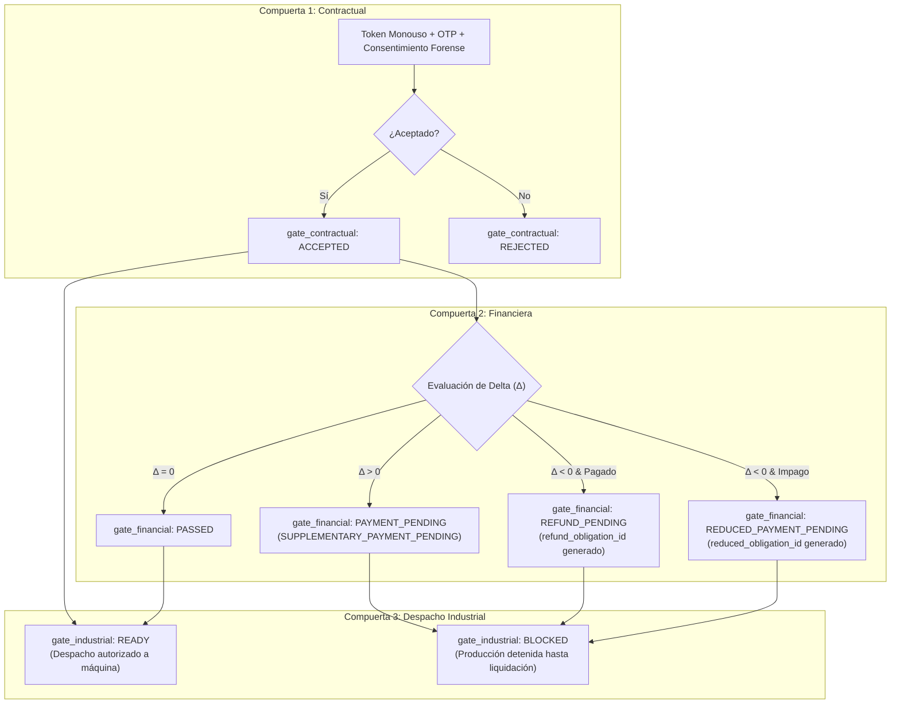

# BUDGET-02D-01 — Consentimiento Forense y Gobernanza de Compuertas Financieras

**Proyecto:** PrintPrice OS  
**Misión:** BUDGET-02D-01 — Remediación de las fracturas críticas de integración E2E  
**Estado:** CERTIFIED  
**Rama:** `feat/budget-02d01-e2e-remediation`  
**Referencia Base:** `744bdd89676c92de2c612152e1be58fe48698fd9`  

---

## 1. Principio de la Triple Compuerta Desacoplada

En PrintPrice OS, la interacción comercial, el flujo financiero y la fabricación industrial se encuentran rigurosamente desacoplados en tres compuertas independientes:



Ninguna aceptación contractual desencadena por sí sola la fabricación ni efectúa cobros o reembolsos sin la intervención y certificación de los módulos especializados.

---

## 2. Remediación de Supervivencia de Consentimiento (BLK-05)

### 2.1 El Riesgo
Si un pedido era cancelado por administración o reasignado a otra imprenta mientras una propuesta de revisión estaba pendiente con el cliente, el cliente aún podía pulsar el enlace del token y aceptar el cambio. Esto generaba inconsistencias críticas:
- Órdenes canceladas que volvían a recibir estados de pago.
- Talleres anteriores que recibían aprobaciones técnicas para pedidos que ya no tenían asignados.

### 2.2 Validación Bajo Bloqueo Transaccional
En [`src/api/services/orderQuoteRevisionService.js`](file:///c:/Users/KIKE/Downloads/ppos-control-plane-phase-10-intelligence-layer/src/api/services/orderQuoteRevisionService.js), se implementó el bloqueo exclusivo `SELECT ... FOR UPDATE` sobre la orden antes de procesar la respuesta del cliente:

```javascript
// Validación estricta de elegibilidad y asignación:
const [orderRows] = await connection.query(
    `SELECT id, status, printhouse_id, offer_print_house 
     FROM orders 
     WHERE id = ? FOR UPDATE`,
    [revision.order_id]
);

const parentOrder = orderRows[0];
const activePrinthouse = parentOrder.printhouse_id || parentOrder.offer_print_house;

// Verificación 1: Estado cancelado o cerrado
const INELIGIBLE_STATUSES = ['CANCELLED', 'REJECTED', 'CLOSED', 'ARCHIVED', 'REFUNDED'];
if (INELIGIBLE_STATUSES.includes(String(parentOrder.status).toUpperCase())) {
    throw new Error(`(ORDER_INELIGIBLE) Cannot accept quote revision on order in state ${parentOrder.status}`);
}

// Verificación 2: Taller reasignado
if (activePrinthouse && activePrinthouse !== revision.printhouse_id) {
    throw new Error(`(PRINTHOUSE_REASSIGNED) Order has been reassigned to another printhouse`);
}
```

---

## 3. Remediación del Diferencial Negativo $\Delta < 0$ (BLK-06)

### 3.1 Prohibición Absoluta de `PASSED`
Bajo la versión anterior, cuando el papel alternativo era más económico que el original ($\Delta < 0$), el sistema asignaba de inmediato `gate_financial: PASSED`, dejando al comprador sin derecho registrado de reembolso y generando un enriquecimiento indebido para el taller o la plataforma.

### 3.2 Contrato Financiero Corregido
Para todo $\Delta < 0$, `gate_financial` **jamás es `PASSED`**. Se aplica la siguiente matriz determinista:

| Estado Previo del Pedido | Condición Económica | Estado Asignado a `gate_financial` | Metadatos y Obligación Contable Generada |
|---|---|---|---|
| **PAID / CONFIRMED** | $\Delta < 0$ | `REFUND_PENDING` | `refund_obligation_id: 'ref_' + hash` — Genera asiento en cola de facturación para emisión de nota de crédito / devolución a pasarela de pago. |
| **PENDING / UNPAID** | $\Delta < 0$ | `REDUCED_PAYMENT_PENDING` | `reduced_obligation_id: 'red_' + hash` — Actualiza el importe pendiente de cobro en el checkout del cliente al precio rebajado. |
| **CUALQUIERA** | $\Delta > 0$ | `PAYMENT_PENDING` / `SUPPLEMENTARY_PAYMENT_PENDING` | `supplementary_amount`: Exige el pago del excedente mediante pasarela antes de autorizar fabricación. |
| **CUALQUIERA** | $\Delta = 0$ | `PASSED` | No requiere movimientos financieros adicionales. |

---

## 4. Trazabilidad Forense y Criptografía de Tokens

1. **Tokens Monouso de 256 bits**: Generados mediante `crypto.randomBytes(32).toString('hex')`.
2. **Cero Texto Plano en Base de Datos**: En `quote_revision_tokens` únicamente se persiste el hash SHA-256 (`token_hash`) y un prefijo de 8 caracteres (`token_prefix`) para indexación no reversible.
3. **Consumo Atómico e Irreversible**:
   ```sql
   UPDATE quote_revision_tokens 
   SET status = 'CONSUMED', consumed_at = NOW() 
   WHERE token_hash = ? AND status = 'PENDING'
   ```
   Cualquier intento posterior devuelve de forma inmediata `HTTP 410 (TOKEN_ALREADY_CONSUMED)`.
4. **Reto OTP para Suplementos Económicos**:
   - Todo suplemento $\Delta > 50\text{ €}$ genera un código OTP numérico de 6 dígitos mediante CSPRNG.
   - El código se almacena exclusivamente como hash con salt SHA-256.
   - El cliente dispone de un máximo de 3 intentos antes de que el token sea revocado permanentemente (`HTTP 429 TOKEN_LOCKED_ATTEMPTS_EXCEEDED`).
5. **Auditoría de Consentimiento**: Se capturan y sellan en el registro:
   - Dirección IP remota (`ip_address`).
   - Cadena de agente de usuario (`user_agent`).
   - Marca temporal UTC de precisión de milisegundo (`timestamp`).
   - Hash del correo del destinatario contractualmente verificado (`recipient_email_hash`).
