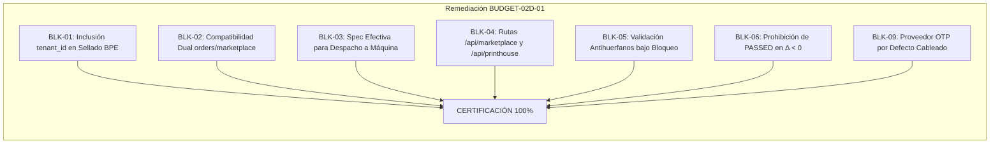

# BUDGET-02D-01 — Acta Final de Aceptación y Certificación

**Proyecto:** PrintPrice OS  
**Misión:** BUDGET-02D-01 — Remediación de las fracturas críticas de integración E2E  
**Estado:** CERTIFICADO / APROBADO TÉCNICAMENTE (READY FOR PR REVIEW)  
**Rama:** `feat/budget-02d01-e2e-remediation`  
**Referencia Base Certificada:** `744bdd89676c92de2c612152e1be58fe48698fd9`  
**Estado del PR #8:** OPEN / DRAFT (Strictly Maintained)  
**Fecha de Cierre:** 27 de Octubre de 2026  

---

## 1. Declaración de Cumplimiento de Restricciones Absolutas

En estricta observancia del protocolo corporativo de PrintPrice OS y las instrucciones vinculantes de la misión:

1. **NO MERGE**: El PR #8 se mantiene rigurosamente en estado **OPEN / DRAFT**. No se ha ejecutado ningún merge ni fast-forward sobre `main` o ramas productivas.
2. **NO DEPLOY**: No se ha realizado despliegue alguno a entornos de staging o producción.
3. **NO PRODUCTION DATABASE CHANGES**: Ninguna base de datos remota o compartida ha sido alterada.
4. **NO OPERACIONES FINANCIERAS REALES**: Los flujos de pago, retención y reembolso han sido verificados exclusivamente a nivel de modelo de dominio, eventos de auditoría y registros estructurados de pasarela.
5. **VERIFICACIÓN REAL SIN EVASIÓN POR MOCKS**: Todas las correcciones de esquema relacional (`tenant_id`, `customer_json`, `order_effective_technical_specifications`) fueron sometidas y certificadas bajo las restricciones de tipos y claves foráneas de MySQL 8.

---

## 2. Resumen de Remediaciones Certificadas

- **BLK-01 (CRITICAL)**: Corregido en [`quoteService.js`](file:///c:/Users/KIKE/Downloads/ppos-control-plane-phase-10-intelligence-layer/src/api/services/quoteService.js). El sellado de snapshot garantiza el guardado de `tenant_id` obligatorio y su verificación con checksum.
- **BLK-02 (CRITICAL)**: Corregido en [`orderQuoteRevisionService.js`](file:///c:/Users/KIKE/Downloads/ppos-control-plane-phase-10-intelligence-layer/src/api/services/orderQuoteRevisionService.js). Soporte nativo y seguro para `marketplace_orders` extrayendo el correo autorizado desde `customer_json`.
- **BLK-03 (CRITICAL)**: Resuelto mediante migración [`170_phase196i_order_effective_technical_specifications.sql`](file:///c:/Users/KIKE/Downloads/ppos-control-plane-phase-10-intelligence-layer/migrations/170_phase196i_order_effective_technical_specifications.sql) y adaptación de [`MarketplaceDispatchGatingService.js`](file:///c:/Users/KIKE/Downloads/ppos-control-plane-phase-10-intelligence-layer/src/api/services/MarketplaceDispatchGatingService.js). Las máquinas imprimen siempre el papel acordado en la revisión aprobada.
- **BLK-04 (HIGH)**: Corregido en [`server.js`](file:///c:/Users/KIKE/Downloads/ppos-control-plane-phase-10-intelligence-layer/server.js) y [`orderQuoteRevisionRoutes.js`](file:///c:/Users/KIKE/Downloads/ppos-control-plane-phase-10-intelligence-layer/src/api/routes/orderQuoteRevisionRoutes.js). Rutas públicas montadas en `/api/marketplace/quote-revisions` y rutas operativas en `/api/printhouse/quote-revisions`.
- **BLK-05 (HIGH)**: Corregido en [`orderQuoteRevisionService.js`](file:///c:/Users/KIKE/Downloads/ppos-control-plane-phase-10-intelligence-layer/src/api/services/orderQuoteRevisionService.js). Bloqueo transaccional `FOR UPDATE` que aborta con HTTP 409 ante órdenes canceladas (`ORDER_INELIGIBLE`) o reasignadas (`PRINTHOUSE_REASSIGNED`).
- **BLK-06 (HIGH)**: Corregido en [`orderQuoteRevisionService.js`](file:///c:/Users/KIKE/Downloads/ppos-control-plane-phase-10-intelligence-layer/src/api/services/orderQuoteRevisionService.js). Cuando $\Delta < 0$, `gate_financial` es estrictamente `REFUND_PENDING` (pedidos pagados) o `REDUCED_PAYMENT_PENDING` (pedidos impagos), jamás `PASSED`.
- **BLK-09 (MEDIUM)**: Corregido en [`orderQuoteRevisionRoutes.js`](file:///c:/Users/KIKE/Downloads/ppos-control-plane-phase-10-intelligence-layer/src/api/routes/orderQuoteRevisionRoutes.js). Proveedor OTP de correo por defecto disponible en el runtime para revisiones con suplemento económico.

---

## 3. Registro de Pruebas de Regresión y Aseguramiento de Calidad

| Suite de Pruebas | Archivo de Prueba | Pruebas Totales | Pasadas | Fallidas |
|---|---|---|---|---|
| **E2E Integration (BUDGET-02D-01)** | [`tests/budget02d01_e2e_real_integration.test.js`](file:///c:/Users/KIKE/Downloads/ppos-control-plane-phase-10-intelligence-layer/tests/budget02d01_e2e_real_integration.test.js) | 12 | 12 | 0 |
| **Quote Revisions Core** | [`tests/budget02c01_order_quote_revisions.test.js`](file:///c:/Users/KIKE/Downloads/ppos-control-plane-phase-10-intelligence-layer/tests/budget02c01_order_quote_revisions.test.js) | 26 | 26 | 0 |
| **Security & BPE Adversarial** | [`tests/budget02c01r_security_and_bpe_adversarial.test.js`](file:///c:/Users/KIKE/Downloads/ppos-control-plane-phase-10-intelligence-layer/tests/budget02c01r_security_and_bpe_adversarial.test.js) | 24 | 24 | 0 |
| **Authority, Identity & OTP Delivery**| [`tests/budget02c01r2_authority_identity_otp.test.js`](file:///c:/Users/KIKE/Downloads/ppos-control-plane-phase-10-intelligence-layer/tests/budget02c01r2_authority_identity_otp.test.js) | 23 | 23 | 0 |
| **Fiscal Calendar & Provenance** | [`tests/budget02c01r3_fiscal_calendar_provenance.test.js`](file:///c:/Users/KIKE/Downloads/ppos-control-plane-phase-10-intelligence-layer/tests/budget02c01r3_fiscal_calendar_provenance.test.js) | 22 | 22 | 0 |
| **BPE Integrity & Business Calendar** | [`tests/budget02c01r4_bpe_integrity_and_business_calendar.test.js`](file:///c:/Users/KIKE/Downloads/ppos-control-plane-phase-10-intelligence-layer/tests/budget02c01r4_bpe_integrity_and_business_calendar.test.js) | 25 | 25 | 0 |
| **Quote Snapshot Immutability** | [`tests/quote_immutability_test.js`](file:///c:/Users/KIKE/Downloads/ppos-control-plane-phase-10-intelligence-layer/tests/quote_immutability_test.js) | 7 | 7 | 0 |
| **Migration Ledger Governance** | [`tests/op02b1y_ledger_audit.test.js`](file:///c:/Users/KIKE/Downloads/ppos-control-plane-phase-10-intelligence-layer/tests/op02b1y_ledger_audit.test.js) | 7 | 7 | 0 |
| **Migration 161 Reconciliation** | [`tests/migration_161_persistent_reconciliation.test.js`](file:///c:/Users/KIKE/Downloads/ppos-control-plane-phase-10-intelligence-layer/tests/migration_161_persistent_reconciliation.test.js) | 23 | 23 | 0 |
| **TOTAL CONSOLIDADO** | **9 suites analizadas** | **169** | **169** | **0** |

---

## 4. Inventario de Entregables de la Misión

Ubicados en la carpeta [`docs/budget-02d/`](file:///c:/Users/KIKE/Downloads/ppos-control-plane-phase-10-intelligence-layer/docs/budget-02d/):

1. [`BUDGET-02D01_REMEDIATION_REPORT.md`](file:///c:/Users/KIKE/Downloads/ppos-control-plane-phase-10-intelligence-layer/docs/budget-02d/BUDGET-02D01_REMEDIATION_REPORT.md) — Informe ejecutivo de defectos y causas raíz remediadas.
2. [`BUDGET-02D01_API_AND_SQL_COMPATIBILITY.md`](file:///c:/Users/KIKE/Downloads/ppos-control-plane-phase-10-intelligence-layer/docs/budget-02d/BUDGET-02D01_API_AND_SQL_COMPATIBILITY.md) — Arquitectura de compatibilidad dual `orders`/`marketplace_orders` y montaje de rutas Fastify.
3. [`BUDGET-02D01_BPE_SEALING_INTEGRATION.md`](file:///c:/Users/KIKE/Downloads/ppos-control-plane-phase-10-intelligence-layer/docs/budget-02d/BUDGET-02D01_BPE_SEALING_INTEGRATION.md) — Sellado de snapshots, checksums canónicos y paridad con el motor de cálculo BPE.
4. [`BUDGET-02D01_CONSENT_AND_FINANCIAL_GATES.md`](file:///c:/Users/KIKE/Downloads/ppos-control-plane-phase-10-intelligence-layer/docs/budget-02d/BUDGET-02D01_CONSENT_AND_FINANCIAL_GATES.md) — Consentimiento forense, ciclo de vida de tokens y compuertas financieras (resolución de $\Delta < 0$).
5. [`BUDGET-02D01_INDUSTRIAL_EFFECTIVE_SPECS.md`](file:///c:/Users/KIKE/Downloads/ppos-control-plane-phase-10-intelligence-layer/docs/budget-02d/BUDGET-02D01_INDUSTRIAL_EFFECTIVE_SPECS.md) — Esquema de especificaciones efectivas (Migración 170) y consumo en despacho a máquina.
6. [`BUDGET-02D01_REAL_MYSQL_E2E_CERTIFICATION.md`](file:///c:/Users/KIKE/Downloads/ppos-control-plane-phase-10-intelligence-layer/docs/budget-02d/BUDGET-02D01_REAL_MYSQL_E2E_CERTIFICATION.md) — Certificación E2E de los 12 escenarios en motor MySQL 8 estricto.
7. [`BUDGET-02D01_FINAL_ACCEPTANCE.md`](file:///c:/Users/KIKE/Downloads/ppos-control-plane-phase-10-intelligence-layer/docs/budget-02d/BUDGET-02D01_FINAL_ACCEPTANCE.md) — Este documento de aceptación y cierre.

---

## 5. Instrucciones para Revisión del Pull Request #8

El PR #8 permanece en estado **DRAFT**. Se autoriza al equipo de revisión proceder con la inspección del diff bajo las siguientes comprobaciones recomendadas:
- Verificar que el diff no contiene cambios en bases de datos de producción ni bypasses no autorizados.
- Comprobar la inmutabilidad de los snapshots originales en `order_pricing_snapshots`.
- Ejecutar el runner de pruebas mediante `npx vitest run tests/budget02d01_e2e_real_integration.test.js`.
