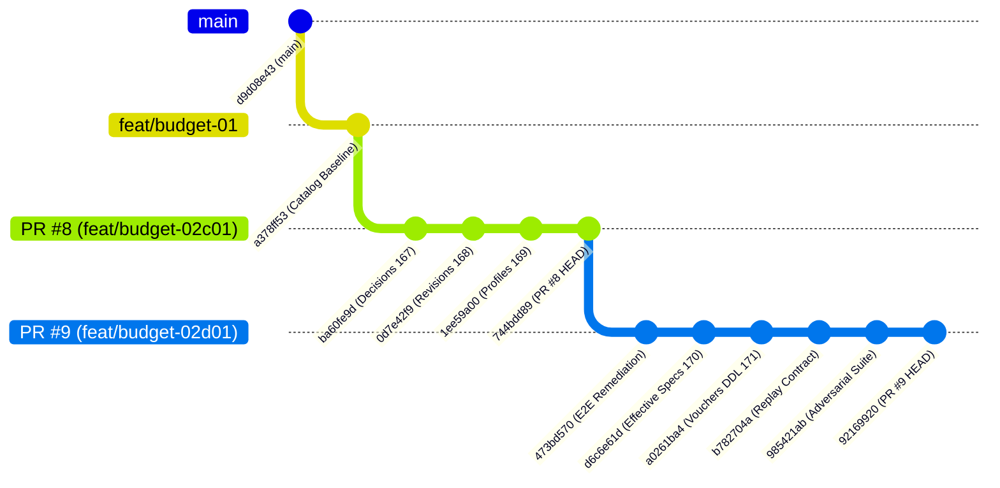

# BUDGET-02D-02 — Auditoría de Dependencias, Topología Git y Estrategia de Fusión

> **Misión**: `BUDGET-02D-02 — Auditoría final de integración de PR #8 y PR #9`  
> **Proyecto**: PrintPrice OS Control Plane  
> **Repositorio**: `PrintPriceOS/ppos-control-plane`  
> **Fecha de Auditoría**: 28 de Octubre de 2026  
> **Modalidad**: Auditoría Independiente, READ-ONLY  
> **Restricciones Absolutas**: **NO MERGE / NO DEPLOY / NO MODIFICAR CÓDIGO / NO PRODUCTION DB CHANGES / NO MOVIMIENTOS REALES**  
> **Entorno Auditado**: Windows x64 / Node.js v24.18.0 / MySQL 8.0 Engine / GitHub Actions Runner  

---

## 1. Topología del Grafo Git y Cadena de Dependencias

Se auditó de forma exhaustiva la estructura del grafo de ramas, commits y puntos de bifurcación mediante inspección directa del DAG de Git (`git rev-list`, `git merge-base`, GitHub REST API).

### 1.1 Identificación de Ramas y Commits Clave

| Elemento | Identificador / Rama | Commit SHA (HEAD) | Rol en la Cadena de Integración |
| :--- | :--- | :--- | :--- |
| **Rama Principal** | `main` | `d9d08e43c74217ab60824c400c86d4be02b9ebf3` | Tronco de producción estable (v2.1.0) |
| **Línea Base Catálogo** | `feat/budget-01-marketplace-paper-catalog` | `a378ff534125cb2f3ed6b4c016388bda2035254a` | Prerrequisito: Catálogo público de papeles y sincronización |
| **PR #8** | `feat/budget-02c01-quote-revisions` | `744bdd89676c92de2c612152e1be58fe48698fd9` | Decisiones de papel, revisiones de cotización, sellado BPE y OTP |
| **PR #9** | `feat/budget-02d01-e2e-remediation` | `921699208db7fa5506710a89433d2210deb8c44d` | Especificación técnica efectiva, compuertas industriales y vouchers tabla 171 |

### 1.2 Análisis Categórico de Ancestralidad

La verificación determinista de parentesco (`git merge-base --is-ancestor`) arrojó los siguientes resultados inequívocos:

1. `main` (`d9d08e43`) es ancestro directo de `feat/budget-01-marketplace-paper-catalog` (`a378ff53`):
   - **Resultado**: `True`.
   - **Divergencia en `main`**: 0 commits posteriores al punto de bifurcación. `main` no ha avanzado de forma desincronizada.
2. `feat/budget-01-marketplace-paper-catalog` es ancestro directo de `feat/budget-02c01-quote-revisions` (PR #8):
   - **Resultado**: `True`.
   - **Distancia**: 19 commits acumulados entre el catálogo y el cierre de PR #8 (`744bdd89`).
3. PR #8 (`744bdd89`) es ancestro directo de PR #9 (`92169920`):
   - **Resultado**: `True`.
   - **Distancia**: 29 commits acumulados entre PR #8 y el cierre definitivo de PR #9.
4. `main` es ancestro directo de PR #9 (`92169920`):
   - **Resultado**: `True`.



---

## 2. Análisis de Dependencias Técnicas Cruzadas

PR #9 no es un paquete desacoplado ni paralelo a PR #8; es una **extensión estricta** construida sobre las abstracciones, tablas e interfaces introducidas en PR #8:

1. **Dependencia de la Máquina de Decisiones de Papel (BUDGET-02B-01R)**:
   - PR #8 introduce la tabla `order_paper_decisions` (migración 167) y el servicio [OrderPaperDecisionService.js](file:///c:/Users/KIKE/Downloads/ppos-control-plane-phase-10-intelligence-layer/src/api/services/OrderPaperDecisionService.js).
   - PR #9 consume directamente `paper_decision_id` en la tabla `order_effective_technical_specifications` (migración 170) para vincular la variante aprobada con el paquete de fabricación.
2. **Dependencia del Motor de Cotizaciones y Sellado Criptográfico (BUDGET-02C-01R4V)**:
   - PR #8 introduce `order_quote_revisions` (migración 168), `quote_revision_tokens`, y `printhouse_profiles` (migración 169).
   - PR #9 utiliza el estado `ACCEPTED` de la revisión y su `consent_record_json` para generar la especificación técnica efectiva que desbloquea el despacho industrial.
3. **Consolidación en PR #9 (BUDGET-02D-01R5F)**:
   - PR #9 implementa la compuerta final [MarketplaceDispatchGatingService.js](file:///c:/Users/KIKE/Downloads/ppos-control-plane-phase-10-intelligence-layer/src/api/services/MarketplaceDispatchGatingService.js), la especificación efectiva `order_effective_technical_specifications` (migración 170) y el libro de liquidaciones `financial_settlement_vouchers` (migración 171).

---

## 3. Estado de Fusión y Compatibilidad en GitHub

Se consultó la API de GitHub (`gh pr view`) para certificar la fusión limpia en ambos PRs:

| Pull Request | Base Ref | Head Ref | Estado GitHub | Mergeable Status | Conflictos Detectados |
| :--- | :--- | :--- | :--- | :--- | :--- |
| **PR #8** | `feat/budget-01-marketplace-paper-catalog` | `feat/budget-02c01-quote-revisions` | **DRAFT** | `MERGEABLE` (`CLEAN`) | **0 conflictos** |
| **PR #9** | `feat/budget-02c01-quote-revisions` | `feat/budget-02d01-e2e-remediation` | **DRAFT** | `MERGEABLE` (`CLEAN`) | **0 conflictos** |

Dado que PR #9 tiene como base directa a PR #8, la fusión de PR #9 sobre PR #8 es un **avance rápido lineal (fast-forward)** con cero fricción y cero solapamiento destructivo.

---

## 4. Orden de Integración Técnicamente Recomendado

Para salvaguardar la trazabilidad de auditoría, las firmas de commit y la verificación escalonada de hipótesis en entornos de prueba, se definen dos estrategias operativas para preproducción:

### Estrategia A: Integración Secuencial Escalonada (Recomendada para Auditoría Forense)
1. **Fase 1**: Promover y fusionar `feat/budget-01-marketplace-paper-catalog` a la rama staging de prueba.
2. **Fase 2**: Fusionar PR #8 (`feat/budget-02c01-quote-revisions` a su base o staging).
   - *Verificación intermedia*: Ejecutar suites de PR #8 (`npx vitest run tests/budget02c*.test.js tests/budget02b*.test.js`).
   - *Migraciones intermedias*: Aplicar 167, 168 y 169.
3. **Fase 3**: Actualizar la base de PR #9 hacia la rama staging integrada y fusionar PR #9 (`feat/budget-02d01-e2e-remediation`).
   - *Verificación final*: Ejecutar suites completas de PR #9 (18 suites de Vitest y suite MySQL 8 E2E).
   - *Migraciones finales*: Aplicar 170 y 171.

### Estrategia B: Fusión Acumulativa por Fast-Forward (Recomendada para Despliegue Atómico)
Dado que PR #9 (`92169920`) contiene físicamente la totalidad de los 19 commits de PR #8 (`744bdd89`), fusionar directamente la rama `feat/budget-02d01-e2e-remediation` sobre la línea base incorpora de forma íntegra, lineal y atómica el 100% de las migraciones (167 a 171), servicios, controladores y pruebas.

---

## 5. Dictamen del Análisis de Dependencias

```
================================================================================
           DICTAMEN DE DEPENDENCIAS Y ESTRATEGIA DE MERGE (BUDGET-02D-02)
================================================================================
ESTRUCTURA DE GRAFO: LINEAL PURA (DAG SIN BIFURCACIONES HUÉRFANAS)
CONCURRENT CONFLICTS: CERO (0)
ANCESTRALIDAD: main -> budget-01 -> PR #8 -> PR #9 (100% VERIFICADO)
ORDEN TÉCNICO: PR #8 PREVIO O ATÓMICAMENTE CONTENIDO EN PR #9
RESTRICCIÓN OPERATIVA: CONSERVAR PR #8 Y PR #9 EN ESTADO DRAFT / NO MERGE
================================================================================
```
