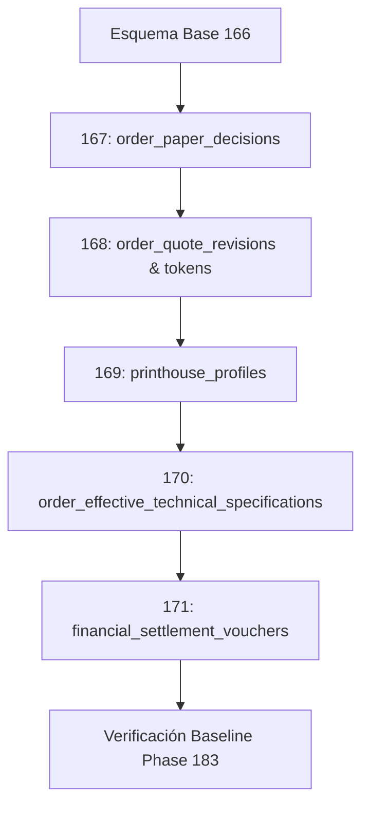

# BUDGET-02D-03 — Runbook Operativo de Migración de Base de Datos para Preproducción

> **Misión**: `MISIÓN BUDGET-02D-03 — Preflight operativo de preproducción aislada`  
> **Proyecto**: PrintPrice OS Control Plane  
> **Repositorio**: `PrintPriceOS/ppos-control-plane`  
> **Fecha de Emisión**: 28 de Octubre de 2026  
> **Modalidad**: Runbook de Planificación Operativa (READ-ONLY)  
> **Restricciones Absolutas**: **NO MERGE / NO DEPLOY / NO MODIFICAR PRODUCCIÓN / NO EJECUTAR MIGRACIONES EN SERVIDORES ACTIVOS / NO OPERACIONES FINANCIERAS REALES**  

---

## 1. Definición y Topología del Esquema Staging

Para ejecutar las migraciones de forma 100% segura, se utilizará una base de datos MySQL 8 aislada, sin enlaces de escritura hacia bases de datos de clientes vivos:

| Atributo | Configuración de Preproducción |
| :--- | :--- |
| **Instancia del Motor** | MySQL 8.0.46 en contenedor `ppos-staging-mysql` |
| **Nombre del Esquema** | `ppos_control_plane_staging` |
| **Collation y Charset** | `utf8mb4 / utf8mb4_unicode_ci` |
| **Modo SQL Mandatorio** | `STRICT_TRANS_TABLES,NO_ENGINE_SUBSTITUTION,ERROR_FOR_DIVISION_BY_ZERO` |
| **Volumen de Almacenamiento** | `ppos_staging_mysql_data_v2` (dedicado e independiente) |
| **Credenciales** | Usuario `ppos_staging_user` con permisos acotados exclusivamente al esquema de staging |

---

## 2. Estrategia de Población de Datos Sintéticos y Anonimizados

Queda terminantemente prohibido volcar volcados de producción con datos personales sin procesar:

1. **Bootstrap del Esquema Base**:
   - Inicializar el esquema hasta la migración 166 utilizando el script canónico:
     ```bash
     docker compose -f docker-compose.staging.yml exec -T control-plane-staging \
       node scripts/bootstrap_staging_persistent_schema.js
     ```
2. **Carga de Catálogo Maestro y Fixtures Sintéticos**:
   - Sembrar el catálogo de papeles y proveedores (`paper_variants`, `printhouses`, `tenants`) utilizando los fixtures de integración certificados (`tests/fixtures/`).
   - Generar pedidos de prueba con identificadores prefijados (`stg_ord_001`, `stg_ord_002`) y tenants simulados (`editorial_montserrat`, `imprenta_bcn`).

---

## 3. Secuencia Paso a Paso de Aplicación de Migraciones (167 a 171)

Una vez obtenida la autorización formal de ejecución, se aplicarán las 5 migraciones añadidas en estricto orden secuencial:



### 3.1 Comandos de Ejecución Secuencial
```bash
# Paso 1: Migración 167 — Decisiones de papel de imprenta
docker compose -f docker-compose.staging.yml exec -T staging-mysql \
  mysql -u ppos_staging_user -p"$STAGING_DB_PASSWORD" ppos_control_plane_staging \
  < migrations/167_phase196f_order_paper_decisions.sql

# Paso 2: Migración 168 — Revisiones de cotización, tokens y eventos de auditoría
docker compose -f docker-compose.staging.yml exec -T staging-mysql \
  mysql -u ppos_staging_user -p"$STAGING_DB_PASSWORD" ppos_control_plane_staging \
  < migrations/168_phase196g_order_quote_revisions.sql

# Paso 3: Migración 169 — Perfiles comerciales, husos horarios y calendarios de imprenta
docker compose -f docker-compose.staging.yml exec -T staging-mysql \
  mysql -u ppos_staging_user -p"$STAGING_DB_PASSWORD" ppos_control_plane_staging \
  < migrations/169_phase196h_printhouse_profiles.sql

# Paso 4: Migración 170 — Especificación técnica efectiva para despacho industrial
docker compose -f docker-compose.staging.yml exec -T staging-mysql \
  mysql -u ppos_staging_user -p"$STAGING_DB_PASSWORD" ppos_control_plane_staging \
  < migrations/170_phase196i_order_effective_technical_specifications.sql

# Paso 5: Migración 171 — Vouchers de liquidación contable y clave UNIQUE anti-replay
docker compose -f docker-compose.staging.yml exec -T staging-mysql \
  mysql -u ppos_staging_user -p"$STAGING_DB_PASSWORD" ppos_control_plane_staging \
  < migrations/171_phase196j_financial_settlement_vouchers.sql
```

---

## 4. Verificación de Integridad y Post-Condiciones del Esquema

Inmediatamente tras la ejecución, se debe comprobar el estado del catálogo en `information_schema`:

```sql
SELECT 
    table_name, 
    engine, 
    table_rows, 
    create_time 
FROM information_schema.tables 
WHERE table_schema = 'ppos_control_plane_staging' 
  AND table_name IN (
    'order_paper_decisions',
    'order_quote_revisions',
    'quote_revision_tokens',
    'order_revision_audit_events',
    'printhouse_profiles',
    'order_effective_technical_specifications',
    'financial_settlement_vouchers'
  );
```

### 4.1 Comprobación Automática de Firmas
Ejecutar la validación criptográfica contra `migrations/migration-integrity-baseline.json`:
```bash
docker compose -f docker-compose.staging.yml exec -T control-plane-staging \
  node scripts/smoke_phase183_migration_integrity.js
```
*Criterio de éxito*: Salida final `Phase 183: PASSED` (174 migraciones, 0 colisiones, 100% coincidencia de checksums SHA-256).

---

## 5. Protocolo de Prueba de Rollback en Copia Descartable

Antes de dar por validada la migración en staging, se debe ejecutar un ensayo de reversión sobre una copia efímera de la base de datos para certificar que el proceso es 100% reversible:

### 5.1 Secuencia Inversa de Rollback
```bash
# Reversión en orden estrictamente inverso de dependencias:
mysql -u ppos_staging_user -p"$STAGING_DB_PASSWORD" ppos_control_plane_staging \
  < migrations/rollback/rollback_171_phase196j_financial_settlement_vouchers.sql

mysql -u ppos_staging_user -p"$STAGING_DB_PASSWORD" ppos_control_plane_staging \
  < migrations/rollback/rollback_170_phase196i_order_effective_technical_specifications.sql

mysql -u ppos_staging_user -p"$STAGING_DB_PASSWORD" ppos_control_plane_staging \
  < migrations/rollback/rollback_169_phase196h_printhouse_profiles.sql

mysql -u ppos_staging_user -p"$STAGING_DB_PASSWORD" ppos_control_plane_staging \
  < migrations/rollback/rollback_168_phase196g_order_quote_revisions.sql

mysql -u ppos_staging_user -p"$STAGING_DB_PASSWORD" ppos_control_plane_staging \
  < migrations/rollback/rollback_167_phase196f_order_paper_decisions.sql
```

### 5.2 Verificación de Reversión Limpia
Comprobar que ninguna de las 7 tablas residuales permanece en el esquema:
```sql
SELECT COUNT(*) AS residual_tables
FROM information_schema.tables 
WHERE table_schema = 'ppos_control_plane_staging' 
  AND table_name IN (
    'order_paper_decisions',
    'order_quote_revisions',
    'quote_revision_tokens',
    'order_revision_audit_events',
    'printhouse_profiles',
    'order_effective_technical_specifications',
    'financial_settlement_vouchers'
  );
-- Debe devolver exactamente 0
```

---

## 6. Procedimiento de Contingencia y Recuperación ante Fallos

En caso de interrupción anormal durante la ejecución DDL (ej. error de sintaxis, timeout o bloqueo):

1. **Aislamiento Inmediato**: Suspender la ejecución de scripts posteriores.
2. **Diagnóstico de Estado**: Consultar `SHOW FULL PROCESSLIST` y `SELECT * FROM information_schema.innodb_trx` para descartar transacciones colgadas.
3. **Restauración desde Snapshot de Respaldo**:
   Restaurar el volumen MySQL al estado previo a la migración mediante el script:
   ```bash
   bash scripts/staging_restore_drill.sh
   ```
4. **Notificación**: Registrar el log completo del error en el expediente de staging antes de cualquier reintento.

> [!IMPORTANT]
> **RECORDATORIO OPERATIVO**: Ninguna de las instrucciones SQL descritas en este runbook ha sido ejecutada en esta misión. El presente documento constituye una guía técnica auditada y lista para su uso tras autorización independiente.
